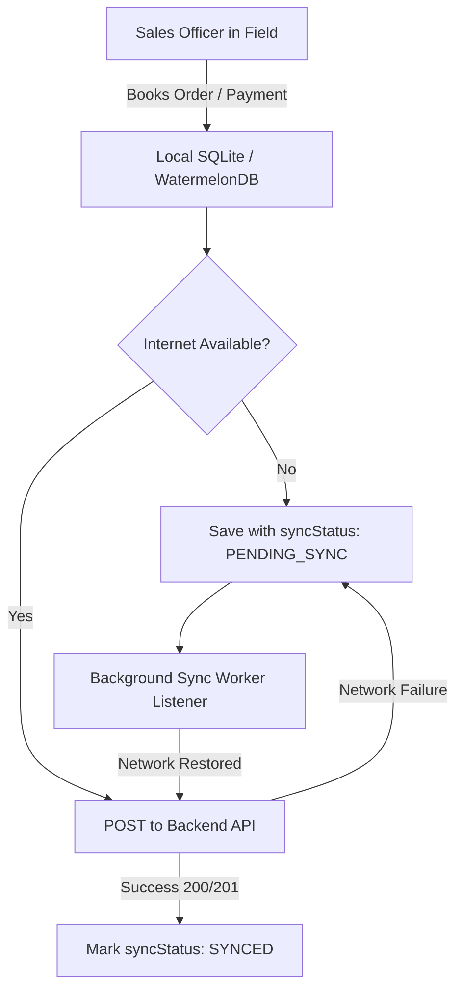

# SHEHSWAR ONE360 — Field Force Mobile App Developer API Specification
**Version:** 1.0.0 (Enterprise Production)  
**Target Platform:** iOS & Android (React Native, Flutter, Swift, Kotlin)  
**Backend Architecture:** NestJS / TypeScript / PostgreSQL / Prisma ORM  
**Security Standard:** Stateless JWT Bearer Authentication & Token Rotation  

---

## 1. Executive Architecture & Overview

The **Shehswar ONE360 Mobile Application** is designed for Field Sales Officers, Area Managers, and Field Agronomists operating across Pakistan's agricultural market. 

### Key Design Principles:
1. **Single Source of Truth**: The mobile app and the ERP Web portal read and write to the **exact same PostgreSQL database records**. An order booked on mobile is instantly visible in the ERP.
2. **Offline-First Resilience**: Field officers frequently work in rural areas with intermittent cellular coverage. The mobile app stores catalog, dealers, and order queues locally and synchronizes atomically with the backend.
3. **Role & Territory Scoping**: Sales Officers only see dealers, orders, and targets belonging to their authorized territory/zone.

---

## 2. Server Base URLs & Networking

| Environment | Base URL | Notes |
| :--- | :--- | :--- |
| **Local Dev (Android Emulator)** | `http://10.0.2.2:4000` | Android loopback alias for host machine |
| **Local Dev (iOS Simulator)** | `http://localhost:4000` | Native loopback to host |
| **Local Dev (Physical Device on LAN)** | `http://<YOUR_COMPUTER_LAN_IP>:4000` | Ensure port `4000` is open on firewall |
| **Staging / Production** | `https://api.shehswar360.com` | HTTPS mandatory |

### Global Headers
Every authenticated request must include:
```http
Content-Type: application/json
Authorization: Bearer <ACCESS_TOKEN>
```

---

## 3. Test Credentials for Development

Use these verified test credentials to develop and test the mobile application:

| Role | Name | Email | Password |
| :--- | :--- | :--- | :--- |
| **Sales Officer** | Usman Tariq | `usman.so.2885@shehswar.test` | `Shehswar@2026!` |
| **Sales Officer** | Hamza Akram | `hamza.so.2892@shehswar.test` | `Shehswar@2026!` |
| **Area Manager** | Bilal Hassan | `bilal.am.2866@shehswar.test` | `Shehswar@2026!` |
| **Business Manager** | Ahmed Raza | `ahmed.bm.2833@shehswar.test` | `Shehswar@2026!` |

---

## 4. Authentication & User Profile APIs

### 4.1 Mobile Login
Authenticates the sales officer and returns a short-lived access token and long-lived refresh token.

- **Method:** `POST`
- **Endpoint:** `/api/mobile/auth/login` (or `/api/v1/auth/login`)
- **Public:** Yes (No Authorization header needed)

#### Request Body
```json
{
  "email": "usman.so.2885@shehswar.test",
  "password": "Shehswar@2026!"
}
```

#### Success Response (`200 OK`)
```json
{
  "tokens": {
    "accessToken": "eyJhbGciOiJIUzI1NiIsInR5cCI6IkpXVCJ9...",
    "refreshToken": "eyJhbGciOiJIUzI1NiIsInR5cCI6IkpXVCJ9...",
    "expiresIn": 900,
    "tokenType": "Bearer"
  },
  "user": {
    "id": "e4f8d29a-1122-4889-8d1e-927361849102",
    "email": "usman.so.2885@shehswar.test",
    "firstName": "Usman",
    "lastName": "Tariq",
    "isSuperAdmin": false,
    "organization": {
      "id": "org_default_01",
      "code": "SHEHSWAR",
      "name": "Shehswar Chemicals Pakistan"
    },
    "company": {
      "id": "cmp_default_01",
      "code": "SCPL",
      "name": "Shehswar Chemicals Pvt Ltd",
      "isParent": true
    },
    "roles": ["ROLE_SALES_OFFICER"],
    "permissions": ["SALES_CREATE", "SALES_VIEW", "DEALER_VIEW"]
  }
}
```

---

### 4.2 Refresh Access Token
When an API request returns `401 Unauthorized`, use the refresh token to obtain a fresh access token without prompting the user to re-enter their password.

- **Method:** `POST`
- **Endpoint:** `/api/v1/auth/refresh`
- **Public:** Yes

#### Request Body
```json
{
  "refreshToken": "eyJhbGciOiJIUzI1NiIsInR5cCI6IkpXVCJ9..."
}
```

#### Success Response (`200 OK`)
```json
{
  "accessToken": "eyJhbGciOiJIUzI1NiIsInR5cCI6IkpXVCJ9...",
  "refreshToken": "eyJhbGciOiJIUzI1NiIsInR5cCI6IkpXVCJ9...",
  "expiresIn": 900,
  "tokenType": "Bearer"
}
```

---

### 4.3 Current Officer Profile (`/auth/me`)
Retrieves the logged-in officer's basic profile.

- **Method:** `GET`
- **Endpoint:** `/api/mobile/auth/me`
- **Headers:** `Authorization: Bearer <ACCESS_TOKEN>`

#### Success Response (`200 OK`)
```json
{
  "id": "e4f8d29a-1122-4889-8d1e-927361849102",
  "email": "usman.so.2885@shehswar.test",
  "firstName": "Usman",
  "lastName": "Tariq",
  "phone": "+92 300 1234567",
  "companyId": "cmp_default_01",
  "organizationId": "org_default_01",
  "company": {
    "id": "cmp_default_01",
    "name": "Shehswar Chemicals Pvt Ltd",
    "code": "SCPL"
  },
  "organization": {
    "id": "org_default_01",
    "name": "Shehswar Chemicals Pakistan"
  }
}
```

---

### 4.4 Complete Market Hierarchy Context
Provides full details of the officer's hierarchy: assigned Territory, Zone, Region, responsible Area Manager, and Business Manager.

- **Method:** `GET`
- **Endpoint:** `/api/v1/auth/context`
- **Headers:** `Authorization: Bearer <ACCESS_TOKEN>`

#### Success Response (`200 OK`)
```json
{
  "id": "e4f8d29a-1122-4889-8d1e-927361849102",
  "firstName": "Usman",
  "lastName": "Tariq",
  "role": "ROLE_SALES_OFFICER",
  "marketAssignments": [
    {
      "id": "ma_98212",
      "roleScope": "TERRITORY",
      "isPrimary": true,
      "regionName": "South Punjab",
      "zoneName": "Multan Zone",
      "territoryName": "Multan Sadar"
    }
  ],
  "responsibleManagers": {
    "businessManager": {
      "id": "bm_019283",
      "name": "Ahmed Raza",
      "phone": "+92 301 9876543"
    },
    "areaManager": {
      "id": "am_018274",
      "name": "Bilal Hassan",
      "phone": "+92 302 4567890"
    }
  },
  "authorizedTerritoryIds": ["terr_multan_01"],
  "authorizedDealerIds": ["dealer_01", "dealer_02", "dealer_03"]
}
```

---

## 5. Product Catalog & Live Stock API

Returns the authoritative product catalog with active pricing and real-time stock across warehouses so sales officers know what is available to sell.

- **Method:** `GET`
- **Endpoint:** `/api/mobile/products`
- **Headers:** `Authorization: Bearer <ACCESS_TOKEN>`

#### Success Response (`200 OK`)
```json
[
  {
    "id": "0194e41b-4b2b-7c38-8c11-123456789abc",
    "productCode": "FP-SUL-80WG",
    "productName": "Sulphur 80% WG (1000g)",
    "defaultSellingPrice": 1450.00,
    "standardCost": 980.00,
    "stockOnHand": 450,
    "stockByWarehouse": [
      {
        "warehouseId": "wh_multan_central",
        "warehouseName": "Multan Central Distribution Depot",
        "quantity": 300
      },
      {
        "warehouseId": "wh_khanewal_transit",
        "warehouseName": "Khanewal Satellite Warehouse",
        "quantity": 150
      }
    ]
  },
  {
    "id": "0194e41b-4b2b-7c38-8c11-987654321def",
    "productCode": "FP-ZIN-33GR",
    "productName": "Zinc Sulphate 33% (3kg)",
    "defaultSellingPrice": 820.00,
    "standardCost": 550.00,
    "stockOnHand": 1200,
    "stockByWarehouse": [
      {
        "warehouseId": "wh_multan_central",
        "warehouseName": "Multan Central Distribution Depot",
        "quantity": 1200
      }
    ]
  }
]
```

---

## 6. Dealer Management APIs

### 6.1 Assigned Dealers Portfolio
Returns all agricultural dealers assigned to the logged-in sales officer.

- **Method:** `GET`
- **Endpoint:** `/api/mobile/sales-officer/dealers`
- **Headers:** `Authorization: Bearer <ACCESS_TOKEN>`

#### Success Response (`200 OK`)
```json
{
  "total": 3,
  "data": [
    {
      "id": "0194e401-d72b-7c18-8f12-321456987a11",
      "code": "DLR-MLT-001",
      "name": "Bismillah Zarai Corporation",
      "businessName": "Bismillah Zarai Corp",
      "contactPerson": "Chaudhry Akram",
      "phone": "+92 300 8654321",
      "city": "Multan",
      "address": "Shop 14, Grain Market, Multan",
      "creditLimit": 2500000.00,
      "currentBalance": 1850000.00,
      "status": "ACTIVE",
      "territory": {
        "id": "terr_multan_01",
        "code": "TER-MLT-01",
        "name": "Multan Sadar"
      }
    }
  ]
}
```

---

### 6.2 Dealer Credit Balance Inquiry
Returns the current ledger balance and credit limit to check whether a dealer can place a new order.

- **Method:** `GET`
- **Endpoint:** `/api/mobile/dealers/:id/balance`
- **Headers:** `Authorization: Bearer <ACCESS_TOKEN>`

#### Success Response (`200 OK`)
```json
{
  "dealerId": "0194e401-d72b-7c18-8f12-321456987a11",
  "dealerName": "Bismillah Zarai Corporation",
  "creditLimit": 2500000.00,
  "currentBalance": 1850000.00,
  "availableCredit": 650000.00,
  "isCreditOverLimit": false
}
```

---

### 6.3 Dealer Ledger Statement
Returns the detailed ledger statement of account (debits, credits, running balances, invoices, and payment receipts).

- **Method:** `GET`
- **Endpoint:** `/api/mobile/dealers/:id/ledger?startDate=2026-09-01&endDate=2026-10-12&limit=50&offset=0`
- **Headers:** `Authorization: Bearer <ACCESS_TOKEN>`

#### Query Parameters:
| Parameter | Type | Required | Description |
| :--- | :--- | :--- | :--- |
| `startDate` | string | Optional | Filter from date (`YYYY-MM-DD`) |
| `endDate` | string | Optional | Filter to date (`YYYY-MM-DD`) |
| `limit` | number | Optional | Default `50`, max `200` |
| `offset` | number | Optional | Default `0` for pagination |

#### Success Response (`200 OK`)
```json
{
  "dealerId": "0194e401-d72b-7c18-8f12-321456987a11",
  "openingBalance": 1200000.00,
  "closingBalance": 1850000.00,
  "totalDebits": 1150000.00,
  "totalCredits": 500000.00,
  "entries": [
    {
      "id": "ledg_001",
      "entryDate": "2026-10-02T10:30:00Z",
      "entryType": "SALES_INVOICE",
      "voucherNumber": "INV-2026-0042",
      "description": "Sales Invoice - Order SO-2026-0089",
      "debit": 1150000.00,
      "credit": 0.00,
      "runningBalance": 2350000.00
    },
    {
      "id": "ledg_002",
      "entryDate": "2026-10-08T14:15:00Z",
      "entryType": "PAYMENT_RECEIPT",
      "voucherNumber": "DRCPT-2026-0019",
      "description": "CHEQUE Payment - Habib Bank Limited",
      "debit": 0.00,
      "credit": 500000.00,
      "runningBalance": 1850000.00
    }
  ]
}
```

---

### 6.4 Dealer Market Hierarchy Context
Provides full commercial chain for the dealer.

- **Method:** `GET`
- **Endpoint:** `/api/v1/dealers/:id/market-hierarchy`
- **Headers:** `Authorization: Bearer <ACCESS_TOKEN>`

#### Success Response (`200 OK`)
```json
{
  "dealerId": "0194e401-d72b-7c18-8f12-321456987a11",
  "dealerCode": "DLR-MLT-001",
  "dealerName": "Bismillah Zarai Corporation",
  "creditLimit": 2500000,
  "currentBalance": 1850000,
  "region": {
    "id": "reg_south_punjab",
    "code": "REG-SP",
    "name": "South Punjab",
    "businessManager": "Ahmed Raza"
  },
  "zone": {
    "id": "zone_multan",
    "code": "ZONE-MLT",
    "name": "Multan Zone",
    "areaManager": "Bilal Hassan"
  },
  "territory": {
    "id": "terr_multan_01",
    "code": "TER-MLT-01",
    "name": "Multan Sadar"
  },
  "salesOfficer": {
    "id": "e4f8d29a-1122-4889-8d1e-927361849102",
    "name": "Usman Tariq",
    "phone": "+92 300 1234567"
  }
}
```

---

## 7. Sales Order Booking APIs

### 7.1 Book New Sales Order
Book a new order directly from the dealer's shop.

- **Method:** `POST`
- **Endpoint:** `/api/mobile/sales-orders`
- **Headers:** `Authorization: Bearer <ACCESS_TOKEN>`

#### Canonical Order Life-Cycle:
1. Mobile app books the order ➔ Status is `PENDING`.
2. ERP Manager reviews and approves/customizes ➔ Status becomes `APPROVED`.
3. Warehouse dispatches and posts invoice ➔ Status becomes `CONVERTED_TO_SALE` (inventory deducted, dealer ledger debited).

#### Request Body
```json
{
  "dealerId": "0194e401-d72b-7c18-8f12-321456987a11",
  "orderDate": "2026-10-12",
  "notes": "Urgent booking for Wheat Season first spraying phase",
  "pricingPhase": "SEASONAL",
  "items": [
    {
      "finishedProductId": "0194e41b-4b2b-7c38-8c11-123456789abc",
      "productName": "Sulphur 80% WG (1000g)",
      "quantity": 100,
      "unitPrice": 1450.00,
      "totalPrice": 145000.00
    },
    {
      "finishedProductId": "0194e41b-4b2b-7c38-8c11-987654321def",
      "productName": "Zinc Sulphate 33% (3kg)",
      "quantity": 50,
      "unitPrice": 820.00,
      "totalPrice": 41000.00
    }
  ]
}
```

#### Success Response (`201 Created`)
```json
{
  "id": "0194e502-8a9c-7d12-9c23-876543210fed",
  "orderNumber": "SO-2026-0094",
  "orderDate": "2026-10-12T00:00:00.000Z",
  "status": "PENDING",
  "dealerId": "0194e401-d72b-7c18-8f12-321456987a11",
  "salesOfficerId": "e4f8d29a-1122-4889-8d1e-927361849102",
  "totalAmount": 186000.00,
  "notes": "Urgent booking for Wheat Season first spraying phase",
  "items": [
    {
      "id": "so_item_01",
      "productName": "Sulphur 80% WG (1000g)",
      "quantity": 100,
      "unitPrice": 1450.00,
      "totalPrice": 145000.00
    },
    {
      "id": "so_item_02",
      "productName": "Zinc Sulphate 33% (3kg)",
      "quantity": 50,
      "unitPrice": 820.00,
      "totalPrice": 41000.00
    }
  ],
  "createdAt": "2026-10-12T16:45:00.000Z"
}
```

---

### 7.2 Get Booked Orders History
Lists all sales orders booked by the sales officer with their live status.

- **Method:** `GET`
- **Endpoint:** `/api/mobile/sales-orders?dealerId=<optional>&status=<optional>&limit=20&offset=0`
- **Headers:** `Authorization: Bearer <ACCESS_TOKEN>`

#### Query Parameters:
| Parameter | Type | Required | Description |
| :--- | :--- | :--- | :--- |
| `status` | string | Optional | `ALL`, `PENDING`, `APPROVED`, `CONVERTED_TO_SALE`, `REJECTED` |
| `dealerId` | string | Optional | Filter orders for a specific dealer |
| `limit` | number | Optional | Number of orders per page (default `20`) |
| `offset` | number | Optional | Offset for pagination |

#### Success Response (`200 OK`)
```json
{
  "total": 12,
  "data": [
    {
      "id": "0194e502-8a9c-7d12-9c23-876543210fed",
      "orderNumber": "SO-2026-0094",
      "orderDate": "2026-10-12T00:00:00.000Z",
      "status": "APPROVED",
      "totalAmount": 186000.00,
      "dealer": {
        "id": "0194e401-d72b-7c18-8f12-321456987a11",
        "name": "Bismillah Zarai Corporation",
        "code": "DLR-MLT-001"
      },
      "items": [
        {
          "productName": "Sulphur 80% WG (1000g)",
          "quantity": 100,
          "unitPrice": 1450.00,
          "totalPrice": 145000.00
        }
      ],
      "salesInvoices": []
    }
  ]
}
```

---

## 8. Dealer Recovery & Payment Collection API

When an officer collects recovery (Cash, Cheque, Online Transfer) from a dealer in the field:

- **Method:** `POST`
- **Endpoint:** `/api/mobile/dealer-payments`
- **Headers:** `Authorization: Bearer <ACCESS_TOKEN>`

### Request Body
```json
{
  "dealerId": "0194e401-d72b-7c18-8f12-321456987a11",
  "paymentType": "CHEQUE",
  "amount": 250000.00,
  "paymentDate": "2026-10-12",
  "bankName": "Habib Bank Limited (HBL)",
  "referenceNumber": "CHQ-8901234",
  "receiptImageUrl": "https://storage.shehswar360.com/receipts/chq_8901234.jpg",
  "notes": "Post-dated cheque for Oct 20th clear"
}
```

#### Payment Types:
- `CASH`
- `CHEQUE`
- `ONLINE_TRANSFER`
- `DEMAND_DRAFT`

### Success Response (`201 Created`)
```json
{
  "id": "0194e612-4d2a-7e32-9c44-765432109fed",
  "receiptNumber": "DRCPT-2026-0028",
  "dealerId": "0194e401-d72b-7c18-8f12-321456987a11",
  "amount": 250000.00,
  "paymentType": "CHEQUE",
  "bankName": "Habib Bank Limited (HBL)",
  "referenceNumber": "CHQ-8901234",
  "status": "CONFIRMED",
  "paymentDate": "2026-10-12T00:00:00.000Z",
  "createdAt": "2026-10-12T17:10:00.000Z"
}
```
*(Automatically creates credit entry in dealer ledger, reducing outstanding balance).*

---

## 9. AI Camera OCR Deposit Slip Scanner API

Allows the sales officer to take a photo of a bank deposit slip or cheque and automatically parse the amount, date, bank name, and reference number:

- **Method:** `POST`
- **Endpoint:** `/api/v1/operations/ocr/upload`
- **Headers:** `Authorization: Bearer <ACCESS_TOKEN>`, `Content-Type: multipart/form-data`

#### Form Data Fields:
- `file`: The binary image captured from camera (JPEG/PNG)
- `documentType`: `"BANK_RECEIPT"`

#### Success Response (`200 OK`)
```json
{
  "success": true,
  "extractedData": {
    "documentType": "BANK_RECEIPT",
    "amount": 250000.00,
    "bankName": "Habib Bank Limited",
    "referenceNumber": "8901234",
    "date": "2026-10-12",
    "confidenceScore": 0.96
  }
}
```

---

## 10. Offline-First Mobile Sync Strategy

Field Officers often operate without reliable cellular internet. The mobile app should implement the following synchronization architecture:



### Local Database Tables Recommendation:
1. `products`: Cache products and stock on hand.
2. `dealers`: Cache officer's assigned dealers and current balances.
3. `offline_orders`: Store booked orders with `sync_status: 'PENDING_SYNC' | 'SYNCED' | 'FAILED'`.
4. `offline_payments`: Store collected receipts with `sync_status`.

---

## 11. Complete Flutter / React Native Interceptor Example

### TypeScript / Axios Example:
```typescript
import axios from 'axios';
import AsyncStorage from '@react-native-async-storage/async-storage';

const apiClient = axios.create({
  baseURL: 'http://10.0.2.2:4000', // Or your LAN IP for physical device
  timeout: 15000,
});

// 1. Request Interceptor: Attach Bearer Token
apiClient.interceptors.request.use(async (config) => {
  const token = await AsyncStorage.getItem('accessToken');
  if (token) {
    config.headers.Authorization = `Bearer ${token}`;
  }
  return config;
});

// 2. Response Interceptor: Auto Token Refresh on 401
apiClient.interceptors.response.use(
  (response) => response,
  async (error) => {
    const originalRequest = error.config;
    if (error.response?.status === 401 && !originalRequest._retry) {
      originalRequest._retry = true;
      const refreshToken = await AsyncStorage.getItem('refreshToken');
      if (refreshToken) {
        try {
          const res = await axios.post('http://10.0.2.2:4000/api/v1/auth/refresh', { refreshToken });
          const newAccessToken = res.data.accessToken;
          const newRefreshToken = res.data.refreshToken;

          await AsyncStorage.setItem('accessToken', newAccessToken);
          await AsyncStorage.setItem('refreshToken', newRefreshToken);

          originalRequest.headers.Authorization = `Bearer ${newAccessToken}`;
          return apiClient(originalRequest);
        } catch (refreshErr) {
          await AsyncStorage.multiRemove(['accessToken', 'refreshToken']);
          // Navigate to Login screen
        }
      }
    }
    return Promise.reject(error);
  }
);

export default apiClient;
```

---

## 12. Standard Error Response Format

All API errors return consistent JSON:
```json
{
  "success": false,
  "error": {
    "code": "Forbidden",
    "message": "Cannot create sales order: dealer belongs to an unauthorized territory.",
    "correlationId": "1d23413a-bff0-4a4e-9c18-0e72485e67dd",
    "timestamp": "2026-10-12T16:50:00.000Z"
  }
}
```

### Common HTTP Status Codes:
- `200 OK`: Request succeeded.
- `201 Created`: Resource (Order, Payment) successfully created.
- `400 Bad Request`: Validation failure (e.g., negative quantity, missing dealer).
- `401 Unauthorized`: Token expired or invalid credentials.
- `403 Forbidden`: Sales officer attempted to access an unauthorized dealer outside their assigned territory.
- `404 Not Found`: Dealer, Product, or Order not found.
- `500 Internal Server Error`: Backend error (includes `correlationId` for log tracing).
