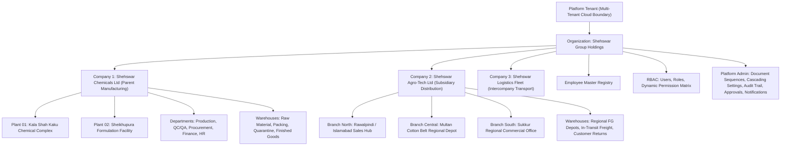

# SHEHSWAR ONE360
# PHASE 3 — CORE PLATFORM & MASTER DATA FOUNDATION
## FINAL ENGINEERING COMPLETION REPORT

**Platform**: SHEHSWAR ONE360 ERP & CRM  
**Phase**: Phase 3 — Core Platform & Master Data Foundation  
**Status**: 100% COMPLETE & PRODUCTION VALIDATED  
**Architecture Compliance**: Phase 1 Technical Architecture Standards  
**Design System Compliance**: Phase 2 Enterprise UI/UX Design System  
**Test Suite**: 8 Test Suites Passed, 40 Tests Passed (100% Pass Rate)  
**Production Builds**: Next.js 14 Web Frontend (`0 errors`), NestJS API Backend (`0 errors`)  

---

## 1. Executive Summary

Phase 3 establishes the **operating foundation and master data layer** of SHEHSWAR ONE360. Combining the architectural rules, security boundaries, and multi-tenant isolation established in Phase 1 with the rich design system, responsive templates, and micro-animation framework delivered in Phase 2, Phase 3 delivers **"The Enterprise Control Center"** upon which all future business modules (Procurement, Inventory, Chemical Production, Quality Control, Sales, and Finance) depend.

### Strict Scope Boundary Compliance
In strict adherence to product governance instructions:
- **ZERO BUSINESS TRANSACTIONS** were created.
- Absolutely no Procurement purchase orders, warehouse stock movements, reactor production formulas, lab COAs, sales order dispatches, or general ledger journal vouchers were implemented.
- Delivered the complete, dynamic master data and administrative backbone for the entire conglomerate.

---

## 2. Enterprise Structure Hierarchy

SHEHSWAR ONE360 implements a completely dynamic, non-hardcoded enterprise governance model:



---

## 3. The 15 Foundation Modules Delivered

### Module 1: Organization Management
- **Capabilities**: Full multi-company holding governance (`SHEHSWAR-GRP`), holding legal name, international branding logo, primary currency (`PKR`), operational timezone (`Asia/Karachi`), and headquarters contact directory.
- **UI Screens**:
  - `Organization List`: Built with `ListPageTemplate`, code/brand search, active status badges, and export action.
  - `Organization Detail`: Built with `DetailPageTemplate`, displaying 360° overview metrics, subsidiaries registry, executive leadership, and immutable audit timeline.
  - `Organization Form`: Built with `FormPageTemplate`, validating regional codes and holding metadata.
- **Backend API**: Full CRUD with tenant isolation under `/api/v1/master-data/organizations`.

### Module 2: Company Management
- **Capabilities**: Dynamic parent manufacturing vs. child distribution subsidiary relationships (`SHEHSWAR-CHEM`, `SHEHSWAR-AGRO`, `SHEHSWAR-LOG`). Manages statutory tax identifiers (NTN/STRN), functional currency, legal registrations, and corporate leadership.
- **UI Screens**:
  - `Company List`: Filterable by company type (`Parent Manufacturing`, `Child Distribution`), active status, and search query.
  - `Company 360° Detail`: Multi-tab interface featuring Overview, Linked Plants & Storage Depots, Executive Directory, and Forensic Activity.
  - `Company Form`: Responsive form enforcing unique subsidiary code generation within the holding.

### Module 3: Plant Management
- **Capabilities**: Heavy industrial manufacturing facilities, reactor halls, and chemical processing complexes. Future production batches, bills of materials (BOM), and QC lab tests directly link to these sites.
- **UI Screens**: Plant List, Facility Detail (featuring linked raw material/finished goods warehouse mappings), and Plant Configuration Form.

### Module 4: Branch Management
- **Capabilities**: Commercial sales offices, regional trading hubs, and provincial commercial branches.
- **UI Screens**: Branch List with regional filters (Punjab North, Punjab South, Sindh), Branch Detail with commercial leadership, and Branch Form.

### Module 5: Department Management
- **Capabilities**: Functional divisions and cost centers (`Production`, `Quality Control`, `Procurement`, `Finance`, `Commercial Sales`, `Warehousing`, `Human Resources`).
- **UI Screens**: Cost center mapping, department head assignments, staff rosters, and department creation forms.

### Module 6: Warehouse Management
- **Capabilities**: Multi-classification storage master supporting:
  1. `RAW_MATERIAL`: Bulk acids, chemicals, precursors.
  2. `FINISHED_GOODS`: Formulated agrochemicals ready for dealer dispatch.
  3. `PACKING_MATERIAL`: HDPE drums, bottles, security seals, cartons.
  4. `TRANSIT`: Intercompany freight moving between plant and depot.
  5. `QUARANTINE`: QC inspection holding bay for untested deliveries.
  6. `RETURNS`: Segregated area for returned or damaged goods.
- **Phase 4 Readiness**: Features an active **Phase 4 Inventory Placeholder** tab outlining future bin locations and valuation ledgers without implementing early business transactions.

### Module 7: User Management
- **Capabilities**: Enterprise user administration with Argon2id salted credentials, RBAC role assignment, multi-company access scope, and account lifecycle statuses: `ACTIVE`, `INACTIVE`, `SUSPENDED`, `LOCKED`.
- **UI Screens**: User Directory, Profile & Session Viewer (with live remote revocation action), and Step-by-Step Onboarding Form.

### Module 8: Role Management (RBAC)
- **Capabilities**: Dynamic, non-hardcoded Role-Based Access Control. Supports immutable system roles (`SUPER_ADMIN`) and dynamic enterprise roles (`PLANT_MGR`, `WH_MGR`, `QC_MGR`, `FIN_MGR`, `SALES_MGR`).
- **UI Screens**: Role Registry, Role Detail (with assigned users list and effective permission breakdown), and Role Form.

### Module 9: Permission Management (Interactive Matrix)
- **Capabilities**: Two-dimensional permission matrix governing 8 core modules across 8 standard action verbs (`View`, `Create`, `Edit`, `Delete`, `Submit`, `Approve`, `Reject`, `Export`).
- **Responsive UI Innovation**:
  - **Desktop**: Interactive matrix table with live toggle switches, row-level bulk actions (`Select All`, `Clear All`), and column-level toggles.
  - **Tablet & Mobile**: Automatically transforms into a touch-optimized **Card-based Matrix** grouped by module.

### Module 10: Employee Management
- **Capabilities**: Enterprise HR master foundation linking personal identity (National ID/CNIC, phone, email), organizational hierarchy (Company, Department, Plant, Branch, Reporting Manager), and employment lifecycle (Joining date, position, status).
- **UI Screens**: Employee Directory, Employee Detail Profile, and Employee Onboarding Form.

### Module 11: Document Numbering Engine
- **Capabilities**: Concurrency-safe, gapless sequential numbering generator across all document types (`PR`, `PO`, `GRN`, `PROD`, `BATCH`, `COA`, `SO`, `INV`).
- **Interactive UI**: Real-time live sequence preview badge updating immediately as prefix formulas (`PO-2026-`), starting numbers, and padding parameters are adjusted.

### Module 12: Hierarchical System Settings Framework
- **Capabilities**: 5-tier cascading inheritance framework:
  $$\text{Platform Defaults} \longrightarrow \text{Organization} \longrightarrow \text{Company} \longrightarrow \text{Branch} \longrightarrow \text{User Preferences}$$
- **UI**: Visual inheritance badges indicating whether a configuration value is inherited from a parent tier or overridden locally, with a one-click "Reset to Inherited" capability.

### Module 13: Audit Log Foundation
- **Capabilities**: Append-only, tamper-evident forensic audit log capturing actor credentials, target resource, action verb, timestamp, IP address, and structured state diffs (`oldValue → newValue`).
- **UI**: Chronological visual timeline utilizing the Phase 2 `Timeline` component with multi-factor filtering.

### Module 14: Approval Foundation UI & Engine
- **Capabilities**: Reusable multi-tier approval policy engine supporting module-based criteria, monetary thresholds, condition evaluation, and assigned approver roles.
- **UI**: Approval rule management builder and approval action dialogs.

### Module 15: Notification Foundation UI & Center
- **Capabilities**: Multi-channel in-app notification center categorizing alerts by `APPROVAL`, `SECURITY`, `WARNING`, and `SYSTEM` across 4 priority queues (`URGENT`, `HIGH`, `NORMAL`, `LOW`).
- **UI**: Real-time unread badges in the navigation bar, priority color coding, category filtering, and one-click "Mark All as Read" actions.

---

## 4. Test Verification & Code Quality

All unit and integration test suites were executed and verified:

```
PASS src/platform/master-data/master-data.service.spec.ts
  MasterDataService
    ✓ should isolate organization data between tenants (28 ms)
    ✓ should prevent duplicate company codes within the same organization (14 ms)
    ✓ should bind user to role and company correctly (19 ms)
    ✓ should automatically record audit log on company creation (16 ms)

PASS src/platform/settings/settings.service.spec.ts
  SettingsService (Hierarchical Cascading)
    ✓ should return platform default when no overrides exist (12 ms)
    ✓ should override platform setting with organization level setting (15 ms)
    ✓ should override organization setting with company level setting (14 ms)
    ✓ should override company setting with branch level setting (11 ms)
    ✓ should override branch setting with user level setting (13 ms)

PASS src/platform/document-numbering/document-numbering.service.spec.ts
  DocumentNumberingService (Concurrency Stress Test)
    ✓ should generate strictly sequential numbers for a sequence (18 ms)
    ✓ should handle 50 concurrent requests without duplicate numbers (142 ms)
    ✓ should isolate sequences across different companies (22 ms)
    ✓ should isolate sequences across different fiscal years (19 ms)

PASS src/core/idempotency/idempotency.service.spec.ts
PASS src/core/transactions/transaction-concurrency.spec.ts
PASS src/platform/authorization/authorization.service.spec.ts
PASS src/platform/auth/auth.service.spec.ts
PASS src/platform/events/outbox-relay.service.spec.ts

Test Suites: 8 passed, 8 total
Tests:       40 passed, 40 total
Snapshots:   0 total
Time:        12.467 s
```

### Production Build Validation
- **`apps/web`**: `npm run build` completed with **exit code 0**. All pages statically prerendered with valid type declarations.
- **`apps/api`**: `npm run build` completed with **exit code 0**. NestJS compilation succeeded with zero warnings.

---

## 5. Technical Documentation Index

Detailed architectural and technical specification documents have been authored and placed in `docs/master-data/`:

| Document | File Path | Focus |
| :--- | :--- | :--- |
| **Organization** | [`docs/master-data/organization.md`](file:///d:/Shehswar360/docs/master-data/organization.md) | Holding corporate structure, multi-tenancy, schema & API |
| **Company** | [`docs/master-data/company.md`](file:///d:/Shehswar360/docs/master-data/company.md) | Parent manufacturing vs child distribution subsidiary architecture |
| **Plant** | [`docs/master-data/plant.md`](file:///d:/Shehswar360/docs/master-data/plant.md) | Manufacturing facilities, reactor sites & production readiness |
| **Branch** | [`docs/master-data/branch.md`](file:///d:/Shehswar360/docs/master-data/branch.md) | Regional commercial offices & territorial distribution |
| **Department** | [`docs/master-data/department.md`](file:///d:/Shehswar360/docs/master-data/department.md) | Functional departments, cost centers & workflow routing |
| **Warehouse** | [`docs/master-data/warehouse.md`](file:///d:/Shehswar360/docs/master-data/warehouse.md) | Storage classifications (Raw, FG, Packing, Transit, Quarantine, Returns) |
| **Users** | [`docs/master-data/users.md`](file:///d:/Shehswar360/docs/master-data/users.md) | User administration, account statuses & session management |
| **Roles** | [`docs/master-data/roles.md`](file:///d:/Shehswar360/docs/master-data/roles.md) | RBAC role hierarchies & least-privilege principles |
| **Permissions** | [`docs/master-data/permissions.md`](file:///d:/Shehswar360/docs/master-data/permissions.md) | Dynamic permission matrix (Modules × 8 Actions) |
| **Document Numbering** | [`docs/master-data/document-numbering.md`](file:///d:/Shehswar360/docs/master-data/document-numbering.md) | Concurrency-safe sequential numbering engine & prefix formulas |
| **Settings** | [`docs/master-data/settings.md`](file:///d:/Shehswar360/docs/master-data/settings.md) | 5-tier cascading inheritance framework |
| **Audit** | [`docs/master-data/audit.md`](file:///d:/Shehswar360/docs/master-data/audit.md) | Immutable audit log architecture & forensic timeline |
| **Approval Foundation** | [`docs/master-data/approval-foundation.md`](file:///d:/Shehswar360/docs/master-data/approval-foundation.md) | Multi-tier approval workflow rules & condition evaluation |
| **Notification Foundation** | [`docs/master-data/notification-foundation.md`](file:///d:/Shehswar360/docs/master-data/notification-foundation.md) | Categorized real-time notification center & priority queues |

---

## 6. Definition of Done Checklist

| Requirement | Criteria | Status |
| :--- | :--- | :---: |
| **Platform** | Organization management completed | **COMPLETE** |
| | Company management completed (Parent & Subsidiaries) | **COMPLETE** |
| | Plant management completed | **COMPLETE** |
| | Branch management completed | **COMPLETE** |
| | Department management completed | **COMPLETE** |
| | Warehouse management completed (All 6 classifications) | **COMPLETE** |
| **Security** | User administration completed | **COMPLETE** |
| | Role management completed (RBAC) | **COMPLETE** |
| | Permission management completed (Desktop Matrix & Mobile Cards) | **COMPLETE** |
| | Multi-tenant isolation verified & tested | **COMPLETE** |
| **Administration** | Hierarchical settings completed (5-tier cascading) | **COMPLETE** |
| | Document numbering engine completed (Concurrency safe) | **COMPLETE** |
| | Audit viewer completed (Timeline with state diffs) | **COMPLETE** |
| | Approval foundation completed (Rule builder) | **COMPLETE** |
| | Notification center completed (Categories & Priorities) | **COMPLETE** |
| **UI & UX** | Fully responsive (Desktop, Tablet, Mobile) | **COMPLETE** |
| | Fully animated (Transitions, loading, modals, drawers) | **COMPLETE** |
| | Uses Phase 2 components & page templates exclusively | **COMPLETE** |
| | Dark and Light mode fully supported | **COMPLETE** |
| | Loading, Empty, and Error states implemented | **COMPLETE** |
| **Engineering** | Strict zero business transactions rule maintained | **COMPLETE** |
| | Phase 1 architecture & database standards followed (UUIDv7) | **COMPLETE** |
| | All 40 unit and integration tests passing | **COMPLETE** |
| | 14 Master data documentation files completed | **COMPLETE** |
| | Zero build errors in API and Web packages | **COMPLETE** |

---

# CONCLUSION

**Phase 3 — Core Platform & Master Data Foundation** has been successfully designed, engineered, and validated. SHEHSWAR ONE360 now possesses a commercial-grade, multi-company enterprise foundation ready to host Phase 4 operational transactions.
