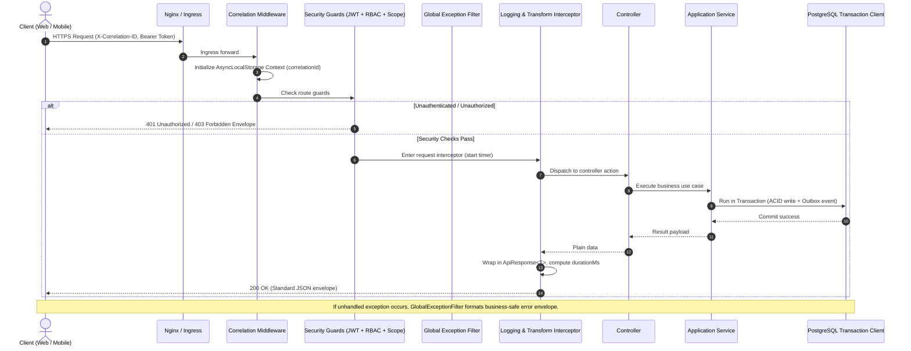

# SHEHSWAR ONE360 — Global API Standards & Request Flow

## 1. REST Endpoint Conventions

1. **Root URL Pattern**: `/api/v1/{bounded-context}/{resource}`
   - Example: `/api/v1/sales/orders`, `/api/v1/inventory/batches`
2. **HTTP Verb Semantics**:
   - `GET`: Safe, idempotent read operations.
   - `POST`: Create a new resource or execute an operational action (e.g. `/orders/{id}/submit-approval`).
   - `PUT`: Complete idempotent resource replacement.
   - `PATCH`: Partial resource update.
   - `DELETE`: Archive or soft-delete a master record.

---

## 2. Request Processing Flow Diagram



---

## 3. Standard Response Contracts

### 3.1 Standard Success Envelope (`ApiResponse<T>`)

```json
{
  "success": true,
  "data": {
    "id": "019abc-...",
    "documentNumber": "SH-PO-2026-000123",
    "totalAmount": "1250000.0000",
    "status": "APPROVED"
  },
  "meta": {
    "correlationId": "f78d9e21-5a34-4b89-a212-9876543210ab",
    "timestamp": "2026-09-25T16:20:00.000Z",
    "durationMs": 35,
    "version": "v1"
  }
}
```

### 3.2 Standard Paginated Envelope (`PaginatedResponse<T>`)

```json
{
  "success": true,
  "data": [{ "id": "uuid-1", "code": "DEALER-001", "name": "Al-Rehman Traders" }],
  "meta": {
    "correlationId": "f78d9e21-5a34-4b89-a212-9876543210ab",
    "timestamp": "2026-09-25T16:20:00.000Z",
    "durationMs": 18,
    "version": "v1",
    "pagination": {
      "page": 1,
      "pageSize": 20,
      "totalItems": 142,
      "totalPages": 8,
      "hasNextPage": true,
      "hasPrevPage": false
    }
  }
}
```

### 3.3 Standard Error Contract (`ApiErrorPayload`)

```json
{
  "success": false,
  "error": {
    "code": "ERR_INSUFFICIENT_BATCH_STOCK",
    "message": "The selected batch does not have sufficient available quantity.",
    "details": {
      "requestedQuantity": "500.0000",
      "availableQuantity": "320.0000",
      "batchNumber": "SH-BATCH-2026-0089"
    },
    "correlationId": "f78d9e21-5a34-4b89-a212-9876543210ab",
    "timestamp": "2026-09-25T16:20:00.000Z"
  },
  "meta": {
    "correlationId": "f78d9e21-5a34-4b89-a212-9876543210ab",
    "timestamp": "2026-09-25T16:20:00.000Z",
    "version": "v1"
  }
}
```

---

## 4. Concurrency & Idempotency Header

For critical financial and inventory state mutations (Posting collections, Goods Receipts, Intercompany dispatches):

- The client passes an `X-Idempotency-Key: {uuid}` header.
- The server checks Redis/PostgreSQL for a processed result within a 24-hour window.
- Duplicate transmissions receive the original recorded response without re-executing state changes or duplicate ledger postings.
