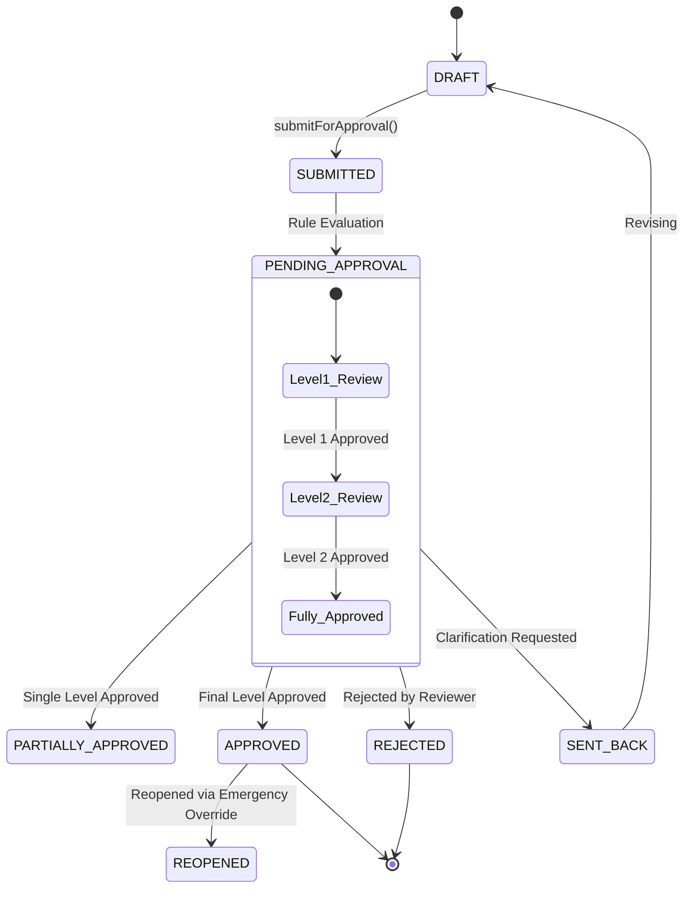

# SHEHSWAR ONE360 — Configurable Approval Workflow Architecture

## 1. Multi-Level Approval State Machine

In enterprise operations, documents undergo strict multi-tiered review cycles:

---

## 2. Rule Evaluation Dimensions

The `ApprovalEngineService` evaluates rules dynamically based on:

1. **Document Type**: Purchase Order (`PO`), Sales Order (`SO`), Production Formula (`FORMULA`), Credit Override (`CREDIT_OVERRIDE`), Stock Adjustment (`STOCK_ADJ`).
2. **Entity Context**: Organization, Company, Plant, or Department.
3. **Monetary Thresholds**:
   - Level 1: Under PKR 500,000 (Department Manager).
   - Level 2: PKR 500,000 to 2,000,000 (General Manager).
   - Level 3: Over PKR 2,000,000 (Director / CEO).
4. **Required Role**: Role code required to execute each approval level.

---

## 3. Approval Engine Schema Foundation

Managed via:

- `approval_rules`: Configurable rules with criteria thresholds and level requirements.
- `approval_requests`: Active tracking of document status, current level, total levels.
- `approval_history`: Append-only history of every review decision, timestamp, and comments.
