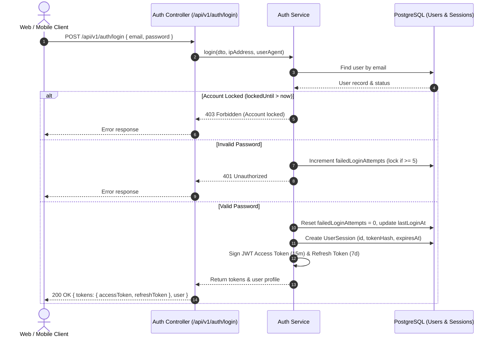

# SHEHSWAR ONE360 — Authentication & Session Architecture

## 1. Authentication Lifecycle

Authentication in ONE360 is centralized and unified across Web, Mobile, and Dealer Portal clients.



---

## 2. Password & Cryptography Standards

- **Hashing Algorithm**: Bcrypt with minimum 12 salt rounds.
- **Password Policy**: Minimum 8 characters, requiring at least one uppercase letter, one lowercase letter, one number, and one special character.
- **Account Lockout Policy**: After 5 consecutive failed login attempts, the account is automatically locked for 15 minutes (`lockedUntil = now() + 15m`). Successful authentication resets `failedLoginAttempts` to 0.

---

## 3. Token Strategy & Expiration

1. **Access Token (JWT)**:
   - Lifespan: **15 minutes** (short-lived).
   - Cryptographic Secret: `JWT_ACCESS_SECRET` (256-bit min).
   - Payload:
     ```json
     {
       "sub": "user-uuid",
       "email": "user@shehswar.com",
       "organizationId": "org-uuid",
       "companyId": "company-uuid",
       "sessionId": "session-uuid",
       "roles": ["ROLE_PLANT_MGR"],
       "permissions": ["production_order:create", "qc_inspection:approve"],
       "iat": 1774500000,
       "exp": 1774500900
     }
     ```
2. **Refresh Token**:
   - Lifespan: **7 days** (long-lived).
   - Cryptographic Secret: `JWT_REFRESH_SECRET`.
   - Stored hashed in the `user_sessions` table.

---

## 4. Session Revocation & Logout

- Immediate revocation is supported: when a user logs out or an admin terminates a session, the `isRevoked` flag is set to `true` on the matching `user_sessions` row.
- Any attempt to use the refresh token after revocation is rejected with `ERR_SESSION_REVOKED` (401).
- Active session tracking allows users to view active logged-in devices (IP address, user agent, last active time).
