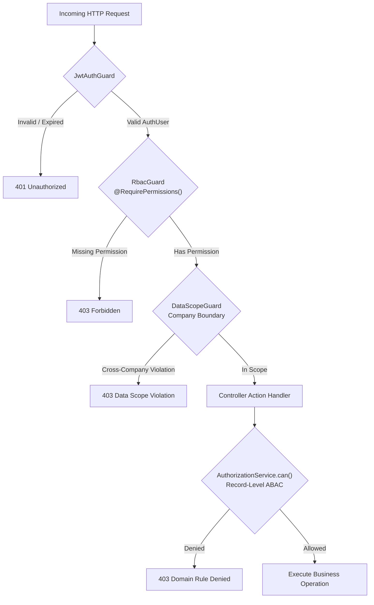

# SHEHSWAR ONE360 — Authorization & Contextual RBAC Architecture

## 1. Access Control Model

SHEHSWAR ONE360 implements a hybrid **Contextual Role-Based Access Control (RBAC) and Attribute-Based Access Control (ABAC)** engine.
Access decisions evaluate:

```text
can(user, action, resource, context) -> boolean
```

Where:

- **`user`**: Authenticated actor, their assigned roles, and granted permissions (`resource:action`).
- **`action`**: Verb being executed (e.g. `view`, `create`, `approve`, `view_cost`, `release_batch`).
- **`resource`**: Target domain entity (e.g. `sales_order`, `costing`, `formula_bom`).
- **`context`**: Operational boundaries (`organizationId`, `companyId`, `plantId`, `warehouseId`, `territoryId`).
- **`targetRecord`**: Entity attributes (e.g. `status === 'APPROVED'`, `amount > 500,000`).

---

## 2. Sensitive Permissions Matrix

Certain operational and financial capabilities carry severe financial and confidentiality risks and require explicit sensitive permissions:

| Permission Code                  | Description                                | Authorized Typical Roles                 | Parent/Child Restriction                  |
| :------------------------------- | :----------------------------------------- | :--------------------------------------- | :---------------------------------------- |
| `costing:view_cost`              | View parent actual unit manufacturing cost | Parent Executive, Finance Controller     | **Strictly forbidden to Child Companies** |
| `costing:view_margin`            | View profit markup and gross margin        | Group CEO, Parent Finance Controller     | **Strictly forbidden to Child Companies** |
| `formula_bom:edit_formula`       | Create or edit manufacturing recipe/BOM    | Chief Nutritionist / Formulation Chemist | Parent Company only                       |
| `formula_bom:approve_formula`    | Lock and approve production formula        | Technical Director / Plant Head          | Parent Company only                       |
| `sales_order:modify_price`       | Override standard dealer price list        | Commercial Director                      | Company-specific                          |
| `dealer:modify_credit_limit`     | Change approved dealer credit ceiling      | Credit Committee, CFO                    | Company-specific                          |
| `dealer:approve_credit_override` | Authorize dispatch exceeding credit limit  | CEO, Finance Director                    | Company-specific                          |
| `finished_batch:release_batch`   | Release manufactured batch from quarantine | Lead QC Officer                          | Plant-specific                            |
| `finished_batch:recall_batch`    | Initiate emergency product batch recall    | QC Director, Plant General Manager       | Group-wide                                |
| `audit_log:view_audit_logs`      | Inspect immutable security audit trails    | Compliance Auditor, Internal Audit       | Organization-wide                         |

---

## 3. NestJS Authorization Guard Flow



---

## 4. Frontend vs. Backend Authorization Rule

- **Backend Authorization is Authoritative**: Every controller endpoint and service operation validates permissions before performing reads or writes.
- **Frontend Permission Checks Exist Only for UX**: UI helpers (`useAuth().can(...)`) dynamically toggle buttons, menu links, and input fields to prevent user frustration, but never constitute security boundaries.
