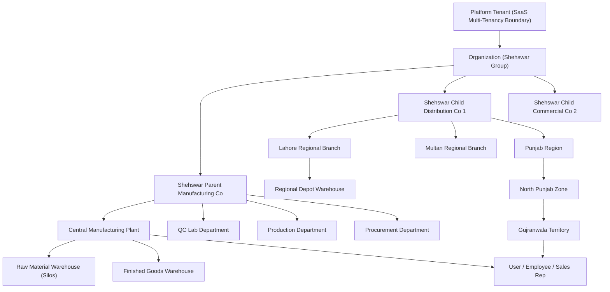

# SHEHSWAR ONE360 — Data Ownership & Hierarchy Architecture

## 1. Ownership Principles

To ensure seamless multi-company operations, reliable intercompany transfers, and clean future SaaS scalability:

1. Every business record belongs to an **Organization** (tenant boundary).
2. Every transactional record belongs to a specific **Company** (legal operating entity).
3. Operational records (such as stock balances and physical movements) are further scoped to the **lowest meaningful operational node**: Plant, Branch, or Warehouse.
4. Commercial records (such as dealers, visits, and sales targets) are scoped through the commercial sales hierarchy: Region -> Zone -> Territory.

---

## 2. Data Ownership Hierarchy Diagram

---

## 3. Data Scoping Rules by Entity Type

| Entity Category                | Attached Scoping Foreign Keys                                           | Access & Isolation Rule                                                                                                       |
| :----------------------------- | :---------------------------------------------------------------------- | :---------------------------------------------------------------------------------------------------------------------------- |
| **System Settings**            | `scope`, `scopeId` (Organization, Company, or Branch)                   | Cascading resolution: Branch overrides Company, Company overrides Organization, Organization overrides Platform default.      |
| **User & Role**                | `organizationId`, `companyId` (primary), optional `plantId`, `branchId` | Users log into their assigned company context. Super Admin can switch active company context.                                 |
| **Raw Materials & BOM**        | `organizationId`, `companyId` (Parent Co)                               | Strictly owned by Parent Company. Child companies cannot query formula ingredients or BOM percentages.                        |
| **Batch Stock**                | `organizationId`, `companyId`, `plantId`, `warehouseId`                 | Owned by the operating company of the warehouse. Child company cannot see or allocate parent silo inventory directly.         |
| **Sales Orders & Receivables** | `organizationId`, `companyId`, `territoryId`                            | Owned by the selling company (Child Co). Visibility restricted to agents assigned to the territory or company sales managers. |
| **Intercompany Order**         | `organizationId`, `parentCompanyId`, `childCompanyId`                   | Dual-visibility record linking parent sales order to child purchase order with an atomic linked reference.                    |
| **Audit Logs**                 | `organizationId`, `companyId`, `actorId`, `correlationId`               | Immutable security log. Company managers view their company logs; Group Auditors view group-wide logs.                        |
