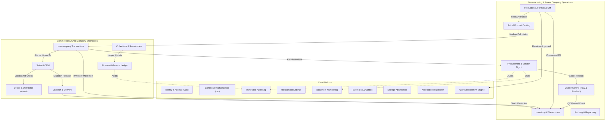

# SHEHSWAR ONE360 — Bounded Domain Boundaries & Module Architecture

## 1. Domain Decomposition Principles

To avoid a tangled "big ball of mud", SHEHSWAR ONE360 adopts strict **Domain-Driven Design (DDD)** bounded contexts within a modular monolith.
Each domain:

1. Owns its domain entities and invariants.
2. Exposes an Application Service API for inter-module synchronous communication.
3. Emits Domain Events for asynchronous decoupled side-effects.
4. Prohibits direct foreign module database table mutations.

---

## 2. Backend Domain Architecture Diagram

---

## 3. Domain Bounded Context Responsibilities

| Bounded Domain             | Primary Responsibility                                                                                          | Key Entities / Concepts                                                         | Inbound Dependencies               |
| :------------------------- | :-------------------------------------------------------------------------------------------------------------- | :------------------------------------------------------------------------------ | :--------------------------------- |
| **Core Platform**          | Identity, authentication, contextual authorization, settings, audit trails, and platform telemetry.             | User, Role, Permission, AuditLog, SystemSetting, DocumentSequence, FileMetadata | Global (all modules)               |
| **Master Data**            | Global references: products, raw materials, vendors, dealers, tax codes, UOMs, and conversion factors.          | Product, Material, UOMConversion, TaxRule                                       | Core Platform                      |
| **Procurement**            | Supplier management, purchase requisitions, PO lifecycle, vendor pricing, and supplier delivery notes.          | Vendor, PurchaseRequisition, PurchaseOrder                                      | Master Data, Approvals, DocNum     |
| **Inventory & Warehouses** | Silo/warehouse tracking, batch stock availability, stock reservations, warehouse transfers, adjustments.        | Warehouse, StockBalance, StockMovement, BatchReservation                        | Master Data, Core Platform         |
| **Quality Control (QC)**   | Lab sampling, test specifications, test results, pass/fail quarantine release, and COA generation.              | QCSpecification, QCInspection, SamplingTest                                     | Master Data, File Storage          |
| **Production & BOM**       | Standard production formulas, ingredient ratios, production orders, manufacturing batches, machine runs.        | FormulaBOM, ProductionOrder, ProductionBatch, Yield                             | Master Data, Approvals, Inventory  |
| **Packing**                | Bulk-to-pack conversions (e.g. bulk feed into 50kg bags), packing material consumption, batch label generation. | PackingOrder, PackSize, PackagingMaterialUsage                                  | Production, Inventory              |
| **Actual Costing**         | Raw material actual weighted average cost, energy/overhead allocation, labor, packaging cost, and markup.       | ProductCostRecord, OverheadRate, CostBreakdown                                  | Production, Packing, Procurement   |
| **Intercompany**           | Parent-to-child commercial transactions, intercompany price lists, atomic linked sales and purchase documents.  | IntercompanyOrder, TransferPricingRule, LinkedReference                         | Costing, Sales, Procurement        |
| **Dealer & CRM**           | Dealer network hierarchy, credit limits, security deposits, dealer territories, visit schedules, and aging.     | Dealer, CreditLimit, DealerAgreement, VisitLog                                  | Core Platform, Master Data         |
| **Sales & Dispatch**       | Sales orders, credit approval overrides, dispatch planning, gate passes, and delivery notes.                    | SalesOrder, DispatchChallan, GatePass                                           | Dealer, Inventory, Approvals       |
| **Collections & Finance**  | Payment recovery, bank deposits, receipt vouchers, dealer ledgers, tax withholdings, and general ledger.        | CollectionReceipt, BankDeposit, LedgerEntry, Account                            | Sales, Intercompany, Core Platform |
