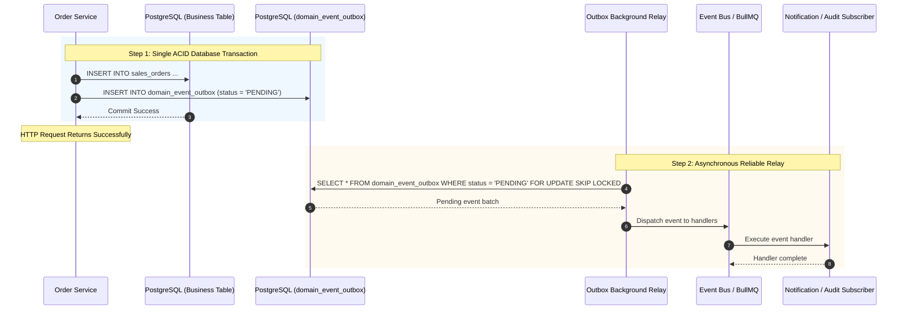

# SHEHSWAR ONE360 — Domain Event & Outbox Architecture

## 1. Event-Driven Principles

SHEHSWAR ONE360 relies on domain events to decouple modules:

- The **originating module** publishes an event describing what occurred (e.g. `purchase_order.approved`).
- **Subscribing modules** (Audit, Notifications, Analytics, Ledger Drafts) react asynchronously without coupling to the originating service's implementation.

---

## 2. Transactional Outbox Pattern Flow

### 2.1 Reliability & Delivery Semantics

- **Delivery Semantic**: **At-Least-Once Delivery**. In distributed asynchronous architectures, network partitions or worker crashes during event acknowledgment can cause an event to be re-dispatched.
- **Safe Worker Claiming**: Concurrent workers claim batches of pending events atomically (`claimPendingEvents(workerId)`). Stale locks (> 5 minutes old) from crashed workers are reclaimed automatically.
- **Exponential Backoff & Retries**: Failed handler executions trigger exponential backoff ($2^{\text{retryCount}} \times 1000\text{ms}$).
- **Dead-Letter Queueing**: If an event fails after 5 retries, it is automatically transitioned to `status: FAILED` (Dead-Letter) and generates a high-priority system administrator alert.
- **Idempotent Consumers**: Because delivery is At-Least-Once, all event subscribers MUST use `IdempotentConsumerService` to record consumed event IDs and ensure duplicate event deliveries do not duplicate business side-effects (e.g. double debiting inventory or double issuing invoices).
- **Event Versioning**: The `eventVersion` column tracks schema evolution across aggregate domain events.

---

## 3. Core Enterprise Domain Events Catalog

| Domain Event Name              | Aggregate Type       | Trigger Condition                     | Intended Side Effects                                   |
| :----------------------------- | :------------------- | :------------------------------------ | :------------------------------------------------------ |
| `purchase_order.approved`      | `purchase_order`     | PO passes final approval rule         | Notify vendor; update committed procurement budget      |
| `goods_receipt.created`        | `goods_receipt`      | Gate receives raw material shipment   | Trigger mandatory QC quarantine inspection              |
| `raw_material_qc.passed`       | `qc_inspection`      | Lab approves chemical/physical test   | Release stock from quarantine to production silo        |
| `raw_material_qc.failed`       | `qc_inspection`      | Lab rejects batch parameters          | Move to reject warehouse; notify procurement            |
| `production_order.released`    | `production_order`   | Shift supervisor releases batch order | Reserve RM silo inventory; schedule machine run         |
| `production_batch.completed`   | `production_batch`   | Milling & mixing run finished         | Record batch yield; calculate variance; trigger FG QC   |
| `finished_batch.released`      | `finished_batch`     | Finished product QC releases batch    | Make available for packing or parent warehouse stock    |
| `intercompany_order.approved`  | `intercompany_order` | Child order approved by parent        | Generate linked parent sales order and child PO         |
| `stock.dispatched`             | `dispatch`           | Loading complete, gate pass signed    | Deduct silo/depot inventory; update batch balance       |
| `sales_invoice.created`        | `invoice`            | Invoice issued to dealer              | Post accounts receivable; queue FBR e-invoice sync      |
| `collection.verified`          | `collection`         | Bank deposit verified by finance      | Update dealer outstanding ledger; release credit hold   |
| `dealer.credit_limit_exceeded` | `dealer`             | Pending orders exceed credit ceiling  | Trigger credit approval workflow; notify sales director |
