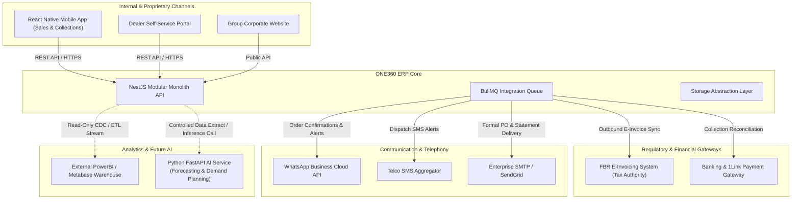

# SHEHSWAR ONE360 — External Integrations & Webhook Architecture

## 1. Integration Abstraction Principles

ONE360 connects to numerous external services and regulatory bodies.

- **Rule 1**: Business domains interact exclusively with **Integration Interfaces** (Adapter Pattern), never direct vendor SDKs.
- **Rule 2**: All incoming webhooks must be cryptographically verified using HMAC signatures and timestamp checks.
- **Rule 3**: External API calls are executed asynchronously via BullMQ queues with exponential backoff retries.

---

## 2. Future Integration Architecture Diagram

---

## 3. Webhook Ingestion Security Standards

For incoming webhooks (e.g. Bank Payment Confirmations, WhatsApp Status Callbacks):

1. **Signature Verification**: Every incoming webhook must include an HMAC-SHA256 signature in its HTTP headers (e.g. `X-Webhook-Signature`). The handler recalculates `crypto.createHmac('sha256', secret).update(rawBody).digest('hex')` and rejects mismatched payloads with HTTP 401.
2. **Timestamp Replay Defense**: Requests with a timestamp older than 300 seconds are rejected.
3. **Idempotent Ingestion**: Webhook event IDs are stored in Redis with a 24-hour TTL; duplicate deliveries return HTTP 200 without re-executing business updates.
