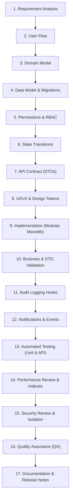

# SHEHSWAR ONE360 — Module Development Lifecycle Standard (17-Step Process)

## 1. Purpose & Mandate

To ensure high enterprise quality, strict financial accuracy, and zero architectural regressions, **no developer is permitted to jump directly from a requirement to creating random frontend screens or ad-hoc database tables**.

Every future business module (Procurement, Inventory, Production, QC, Packing, Costing, Intercompany, Sales, CRM, Finance) **MUST** strictly execute this 17-step lifecycle.

---

## 2. The 17-Step Module Development Lifecycle

---

### Step 1: Requirement Analysis

- Interview business domain owners (Shehswar plant managers, accountants, sales directors).
- Document business constraints, regulatory requirements (FBR, ISO), and edge cases.

### Step 2: User Flow

- Diagram end-to-end user journeys from trigger to completion across all participant roles.

### Step 3: Domain Model

- Define bounded context entities, value objects, invariants, and domain aggregates.
- Define what data belongs to Parent Company vs. Child Company.

### Step 4: Data Model & Migrations

- Write Prisma schema updates. Enforce `DECIMAL(18, 4)` on all financial and quantity fields.
- Include foreign keys, composite indexes, tenant discriminators, and soft-delete/immutability rules.
- Generate and test migration scripts.

### Step 5: Permissions & RBAC

- Register new permissions in `@shehswar/types` (`enums.ts`) and database seed.
- Mark sensitive permissions (e.g. `view_cost`, `modify_price`) explicitly.

### Step 6: State Transitions

- Model allowed document statuses and legal state machine transitions using `ApprovalEngineService`.

### Step 7: API Contract

- Define versioned REST endpoints (`/api/v1/...`).
- Create typed request DTOs with `class-validator` and typed response types in `@shehswar/types`.

### Step 8: UI/UX & Design Tokens

- Design user interfaces adhering to the Phase 2 Design System and accessibility guidelines.

### Step 9: Implementation

- Implement the 4-layer NestJS structure: `domain/`, `application/`, `infrastructure/`, `presentation/`.
- Ensure controllers contain zero business logic; business logic resides in application services.

### Step 10: Business & DTO Validation

- Validate incoming inputs at the presentation layer and enforce invariants in domain services.

### Step 11: Audit Logging Hooks

- Attach `AuditService.record()` calls to all state mutations, status transitions, and sensitive field views.

### Step 12: Notifications & Events

- Define domain events in `@shehswar/types` and write them to `DomainEventOutbox`.
- Configure notification rules and templates.

### Step 13: Automated Testing

- Write unit tests for domain math (`Money`, `Quantity`) and integration tests for API endpoints and transactions.

### Step 14: Performance Review & Indexes

- Review query execution plans (`EXPLAIN ANALYZE`).
- Verify indexes exist on all foreign keys, tenant IDs, and filter columns. Prevent N+1 queries.

### Step 15: Security Review & Isolation

- Verify `DataScopeGuard` prevents cross-company data leakage.
- Confirm child company accounts cannot access parent confidential fields.

### Step 16: Quality Assurance (QA)

- Validate complete user flows in the staging environment. Test error conditions and rollbacks.

### Step 17: Documentation & Release Notes

- Update module documentation, API specs in Swagger, and update ADRs if new architectural patterns were introduced.
