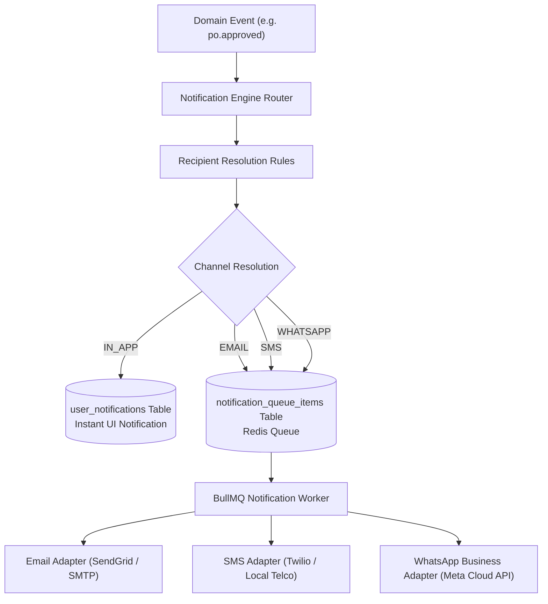

# SHEHSWAR ONE360 — Decoupled Notification Architecture

## 1. Decoupled Pipeline Design

ONE360 decouples business operations from telecommunication and messaging providers:

- **Business Event**: `purchase_order.approved` emits an event with business data.
- **Notification Engine**: Resolves subscribed recipients, loads the channel template, substitutes variables, and queues delivery.
- **Worker / Adapter**: BullMQ worker executes actual delivery via SMTP, Twilio, or Meta WhatsApp Cloud API.

---

## 2. Notification Flow

---

## 3. In-App vs. External Queueing

1. **In-App Notifications**:
   - Written synchronously to `user_notifications` (`userId`, `title`, `body`, `linkUrl`, `isRead`).
   - Displayed immediately in the web app header bell icon and mobile app push.
2. **External Channels (Email, SMS, WhatsApp)**:
   - Queued asynchronously into `notification_queue_items`.
   - Protects ERP transactional speed against external telecommunication network latencies.
