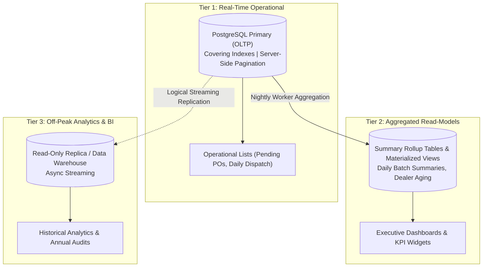

# SHEHSWAR ONE360 — Reporting & Read-Model Architecture

## 1. Reporting Challenges in Manufacturing ERP

Enterprise ERP systems face two competing database demands:

- **OLTP (Online Transaction Processing)**: High concurrency, low latency, fine-grained row locks (e.g. goods receipt, batch reservation).
- **OLAP (Online Analytical Processing)**: Heavy aggregation, wide table scans, multi-year summaries (e.g. 12-month raw material consumption variance, consolidated P&L).

Running OLAP queries directly on active transactional tables causes table locking and connection pool starvation.

---

## 2. Tiered Reporting Strategy

---

## 3. Implementation Rules

1. **Server-Side Pagination Mandate**: Operational list endpoints must use `PaginationDto` (`page`, `pageSize`, `skip`, `take`). Returning unbounded datasets (`SELECT *`) is forbidden.
2. **Materialized Views**: Aggregation tables (e.g. `dealer_monthly_sales_summary`) are refreshed during off-peak periods using `REFRESH MATERIALIZED VIEW CONCURRENTLY`.
3. **Read Replica Routing**: Data queries for heavy reports will be routed to a read-only database replica via Prisma connection pooling.
