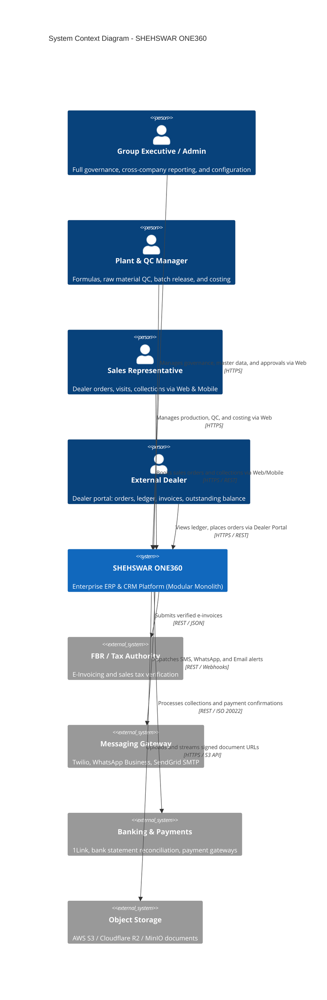
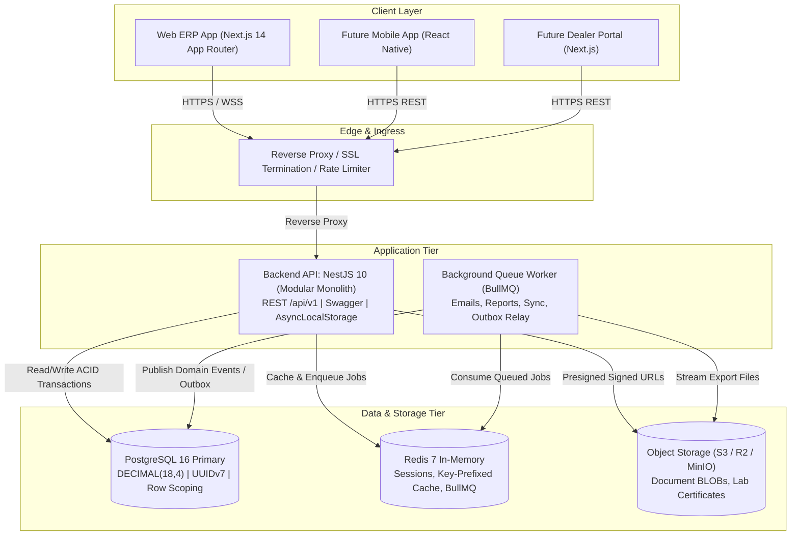

# SHEHSWAR ONE360 — System Overview & Architecture Foundation

## 1. Executive Summary

**SHEHSWAR ONE360** is a modular, scalable, multi-company-ready, and future-SaaS-ready Enterprise Resource Planning (ERP) and Customer Relationship Management (CRM) platform. Designed for commercial enterprise deployment with **Shehswar Group** as its flagship enterprise customer, ONE360 unifies manufacturing operations, procurement, inventory tracking, batch traceability, production formula/BOM management, actual product costing, intercompany transactions, and dealer sales networks.

Phase 1 establishes the **technical foundation and architectural contract** across all layers of the platform, guaranteeing that subsequent functional phases (Procurement, Production, Inventory, Costing, Intercompany, Sales, CRM, Finance) plug in without architectural rework or schema dismantling.

---

## 2. System Context Diagram (C4 Level 1)

---

## 3. Container Architecture Diagram (C4 Level 2)

---

## 4. Architectural Tenets & Invariants

1. **API-First Architecture**: All platform features are built as versioned RESTful APIs. Web, mobile, and external integrations consume identical endpoints and validation contracts.
2. **Modular Monolith First**: Single deployable repository organized into bounded business contexts. Eliminates premature distributed transaction complexity while enforcing clean code boundaries.
3. **No Floating-Point Financials**: All currency and quantity calculations use exact `DECIMAL(18, 4)` in PostgreSQL and `Money` / `Quantity` value objects backed by Decimal.js in Node.js.
4. **Contextual Multi-Company Data Isolation**: Hard tenant isolation between organizations; strict contextual isolation between Parent and Child companies. Child companies are physically prevented from reading parent manufacturing costs and profit margins.
5. **Post / Reverse / Adjust Immutability**: Historical financial postings and stock ledger movements cannot be silently edited or hard deleted. Corrections occur strictly via auditable reversal transactions.
6. **No Binary BLOBs in PostgreSQL**: Documents, photos, and PDFs are stored in S3-compatible object storage via expiring signed URLs; PostgreSQL stores only metadata.
7. **Transactional Outbox for Domain Events**: Entity mutations and domain event records commit atomically in the same database transaction, eliminating event loss.
