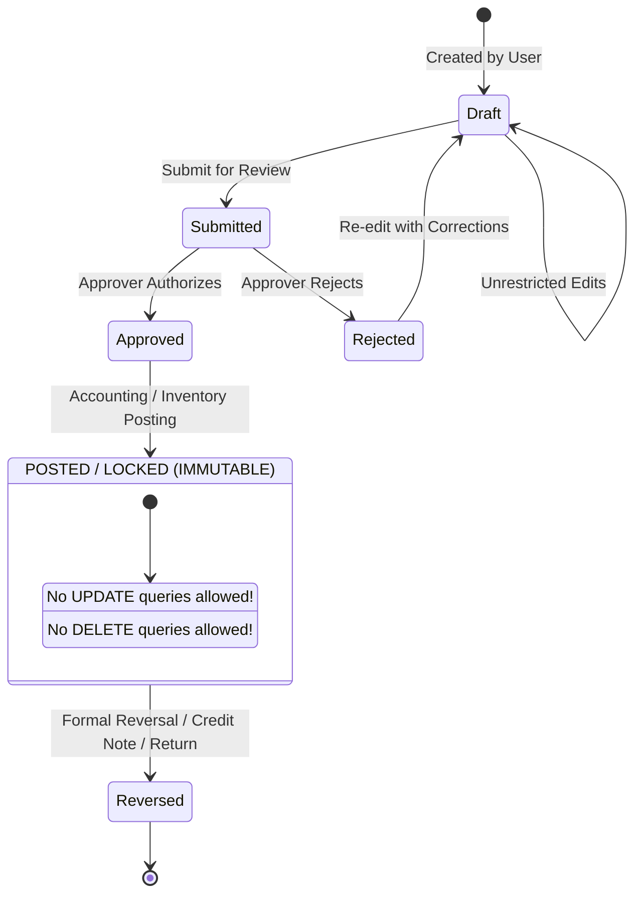

# SHEHSWAR ONE360 — Versioning & Immutability Architecture

## 1. Core Rule: Historical Snapshot Invariance

In industrial ERP systems, master configuration data (recipes, pricing, QC specifications, tax rates) changes over time.
**Historical transactions must NEVER dynamically link to mutable master records.**

When an operational transaction occurs (e.g. Production Order, Invoice, Goods Receipt), it must store a permanent, immutable reference to the **exact version ID** of the master record active at the moment of execution.

---

## 2. Versioned Master Records

| Master Entity                           | Versioning Pattern                                                               | Execution Invariance Rule                                                                                                                                                                                       |
| :-------------------------------------- | :------------------------------------------------------------------------------- | :-------------------------------------------------------------------------------------------------------------------------------------------------------------------------------------------------------------- |
| **Formula / BOM**                       | Incremental Versioning (`version: 1, 2, 3...`) with `status: ACTIVE \| ARCHIVED` | When a Production Order is created, it captures `formula_id` AND `formula_version`. If a nutritionist alters the formula tomorrow, yesterday's completed batches retain their exact historical BOM composition. |
| **QC Specification**                    | Versioned Test Thresholds                                                        | Quality tests are evaluated against the specific QC specification version active when the PO or production batch was released.                                                                                  |
| **Price List**                          | Effective Date Range + Version                                                   | Historical sales orders and invoices permanently record `unit_price` at line level. Updating the price list does not retroactively alter posted or pending orders.                                              |
| **Costing & Overhead Allocation Rules** | Fiscal Period Snapshots                                                          | Monthly manufacturing overhead allocation rules are locked at period close.                                                                                                                                     |

---

## 3. Posted Document Immutability Lifecycle

Operational and financial documents in Shehswar ONE360 follow a strict directional state machine:

### Prohibitions on Posted Records

1. **No In-Place Modification**: SQL `UPDATE` queries altering prices, quantities, accounts, or items on `POSTED` documents are rejected by database triggers and domain service guards.
2. **No Physical Deletion**: SQL `DELETE` queries on posted transactions are prohibited.
3. **Correction via Offsetting Entry**: Errors on posted documents must be corrected by creating a formal reversal transaction (e.g., Credit Note, Debit Note, Stock Adjustment, or Journal Voucher Reversal).
