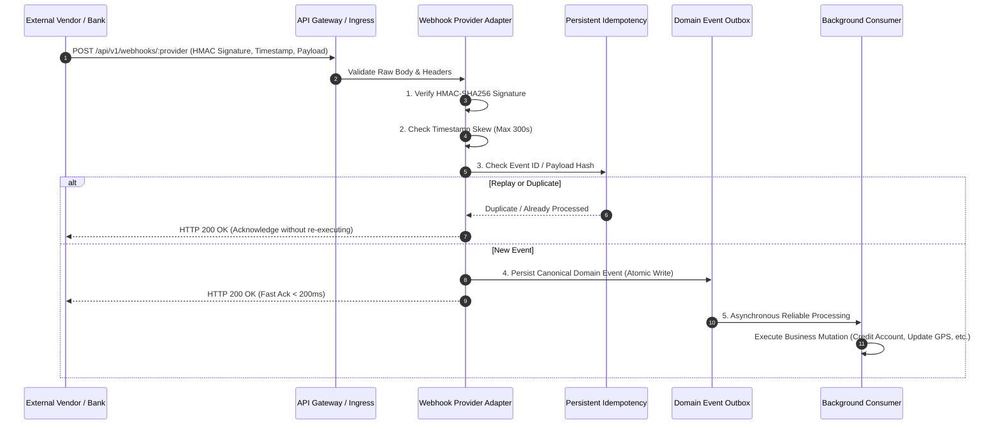

# SHEHSWAR ONE360 — Inbound & Outbound Webhook Architecture

## 1. Overview

External integrations (banks, payment gateways, couriers, telemetry sensors, supplier portals) communicate asynchronously via webhooks. To protect against spoofing, replay attacks, and dual processing, all inbound webhooks follow a strict defense-in-depth pipeline.

---

## 2. Inbound Webhook Security Pipeline



---

## 3. Mandatory Defense Layers

### 1. Cryptographic Signature Verification

- Every provider webhook must supply an HMAC signature in headers (e.g. `X-Signature-SHA256`, `Stripe-Signature`).
- The raw request body is verified against the shared secret stored in the secret vault:
  ```typescript
  const expectedSig = crypto.createHmac('sha256', secret).update(rawBody).digest('hex');
  if (!crypto.timingSafeEqual(Buffer.from(receivedSig), Buffer.from(expectedSig))) {
    throw new UnauthorizedException('Invalid webhook signature');
  }
  ```

### 2. Timestamp Skew & Replay Protection

- Incoming webhooks must include an epoch timestamp in headers.
- If the difference between `Date.now()` and the incoming timestamp exceeds **300 seconds (5 minutes)**, the request is rejected immediately to block replay attacks.

### 3. Provider Adapter Pattern

- Vendor-specific payload schemas (e.g. Meezan Bank, JazzCash, TCS Courier, IoT Silo) must **NEVER** leak directly into ERP domain services.
- Dedicated adapters translate vendor payloads into standardized internal domain events:
  - `MeezanBankWebhookAdapter` → `bank_payment.received`
  - `TcsCourierWebhookAdapter` → `shipment.status_updated`

### 4. Fast Acknowledgment & Asynchronous Processing

- Webhook endpoints must never perform long-running business logic or synchronous transactions in the HTTP handler.
- Handlers validate, persist to `DomainEventOutbox`, and return `HTTP 200 OK` within 200ms.
- Downstream workers process the event with retry backoff and dead-letter queueing.
