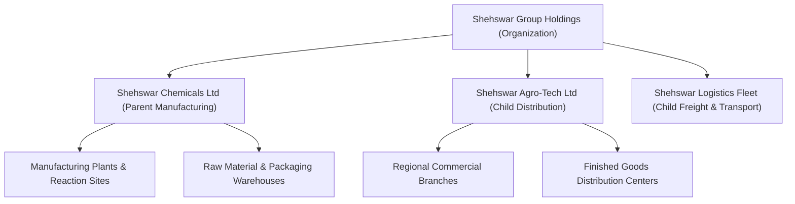

# Company Management Architecture & Specification

## 1. Executive Overview

In **SHEHSWAR ONE360**, the `Company` entity represents an operating legal business entity, subsidiary, or joint-venture operating under an `Organization`. Shehswar ONE360 distinguishes between:
1. **Parent Manufacturing Companies** (e.g., *Shehswar Chemicals Ltd*): Holds industrial plants, batch recipes, raw material inventories, and heavy reactors.
2. **Child Distribution Subsidiaries** (e.g., *Shehswar Agro-Tech Ltd*, *Shehswar Logistics Ltd*): Responsible for regional sales, finished goods distribution, dealer credit limits, and freight transport.

---

## 2. Entity Schema & Standards

The `Company` schema enforces strict multi-company separation while enabling authorized intercompany transactions.

| Field | Type | Constraint | Description |
| :--- | :--- | :--- | :--- |
| `id` | `VARCHAR(36)` | `PRIMARY KEY` | UUIDv7 primary key |
| `organizationId` | `VARCHAR(36)` | `NOT NULL, FK` | Parent holding organization reference |
| `code` | `VARCHAR(50)` | `NOT NULL` | Unique subsidiary business code (e.g. `SHEHSWAR-CHEM`) |
| `name` | `VARCHAR(255)` | `NOT NULL` | Operating trade name |
| `legalName` | `VARCHAR(255)` | `NULLABLE` | Full statutory entity registration title |
| `companyType` | `VARCHAR(50)` | `NOT NULL` | `PARENT_MANUFACTURING`, `CHILD_DISTRIBUTION`, etc. |
| `isParent` | `BOOLEAN` | `NOT NULL, DEFAULT false` | Flag designating parent entity in holding group |
| `taxId` | `VARCHAR(100)` | `NULLABLE` | Statutory tax identification number (NTN / GST / STRN) |
| `currencyCode` | `VARCHAR(10)` | `NOT NULL, DEFAULT 'PKR'` | Operating currency for general ledger balances |
| `email` | `VARCHAR(255)` | `NULLABLE` | Official business contact email |
| `phone` | `VARCHAR(50)` | `NULLABLE` | Corporate telephone |
| `address` | `TEXT` | `NULLABLE` | Registered factory / office premises address |
| `managerName` | `VARCHAR(255)` | `NULLABLE` | Managing Director / CEO / Plant Chief |
| `isActive` | `BOOLEAN` | `NOT NULL, DEFAULT true` | Active company flag |
| `createdAt` | `TIMESTAMPTZ` | `NOT NULL` | Creation timestamp |
| `updatedAt` | `TIMESTAMPTZ` | `NOT NULL` | Update timestamp |

---

## 3. Multi-Tenant Scoping & Security

1. **Isolation Guard**: Every user belongs to one or more authorized companies. A JWT token contains `companyId` in its active context. The `AuthorizationService` blocks any query across unauthorized subsidiaries.
2. **Intercompany Clearing**: Phase 1 established that intercompany sales between *Shehswar Chemicals Ltd* and *Shehswar Agro-Tech Ltd* require distinct sequence numbers and dual-sided ledger balance reconciliation.

---

## 4. UI Architecture & Responsive Interaction

The Company Management UI supports desktop, tablet, and mobile views:
- **List Page**: Filterable by company type, status, and search query. Shows parent badges, linked plants, and warehouse counts.
- **Detail Page**: 360° view containing tabs:
  - *Overview*: Tax ID, legal name, currency, manager, and registration status.
  - *Plants & Warehouses*: Summary of manufacturing and storage nodes linked to this entity.
  - *Activity & Audit*: Immutable timeline of status and metadata modifications.
- **Create / Edit Form**: Validates unique company code within the organization, tax identification format, and company type classification.
