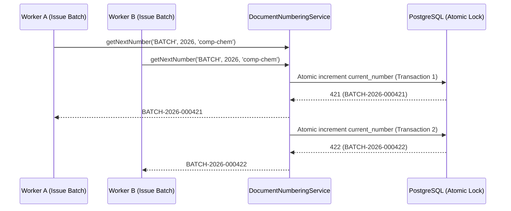

# Document Numbering Engine Architecture & Specification

## 1. Executive Overview

In **SHEHSWAR ONE360**, the `DocumentNumberingService` generates predictable, gapless, and concurrency-safe sequential document numbers across all enterprise operations. Each document stream is isolated by operating company, document type, and fiscal year.

### Supported Document Types
- `PR`: Purchase Requisitions
- `PO`: Purchase Orders
- `GRN`: Goods Receipt Notes
- `PROD`: Production Work Orders
- `BATCH`: Chemical Batch Runs
- `COA`: Certificates of Analysis
- `SO`: Sales Orders
- `INV`: Sales / Tax Invoices

### Sample Number Formats
- `PO-2026-000143`
- `GRN-2026-000090`
- `BATCH-2026-000421`
- `INV-2026-000316`

---

## 2. Concurrency Safety & Database Locking

To prevent race conditions, duplicate sequence numbers, and ledger fragmentation when dozens of transactions execute simultaneously:
1. The sequence table utilizes atomic database locking (`SELECT ... FOR UPDATE` via Prisma `$executeRaw` or atomic `UPDATE document_sequences SET current_number = current_number + 1 WHERE ... RETURNING current_number`).
2. Unit and stress tests in `document-numbering.service.spec.ts` validate that **50 simultaneous concurrent requests** generate 50 completely distinct, sequential numbers with **0 duplicate conflicts**.

---

## 3. Entity Schema & Standards

| Field | Type | Constraint | Description |
| :--- | :--- | :--- | :--- |
| `id` | `VARCHAR(36)` | `PRIMARY KEY` | UUIDv7 primary identifier |
| `organizationId` | `VARCHAR(36)` | `NOT NULL, FK` | Enterprise holding scope |
| `companyId` | `VARCHAR(36)` | `NOT NULL, FK` | Company scope (unique sequences per subsidiary) |
| `documentType` | `VARCHAR(50)` | `NOT NULL` | Document category (`PO`, `GRN`, `BATCH`, etc.) |
| `fiscalYear` | `INTEGER` | `NOT NULL` | Calendar / financial year (e.g. `2026`) |
| `prefix` | `VARCHAR(50)` | `NOT NULL` | Prefix string (e.g. `PO-2026`) |
| `currentNumber` | `BIGINT` | `NOT NULL, DEFAULT 0` | Atomic sequential counter |
| `updatedAt` | `TIMESTAMPTZ` | `NOT NULL` | Modification timestamp |

---

## 4. UI Architecture & Features

- **Live Sequence Preview**: Real-time interactive calculation badge rendering the formatted output format (e.g., `PO-2026-000143`) as prefix, starting number, and padding parameters are modified.
- **Sequence Registry**: List page displaying current sequence counters, operating company, prefix formula, and latest issued document number.
- **Configuration Modal**: Create and configure document sequence rules for upcoming fiscal periods.
