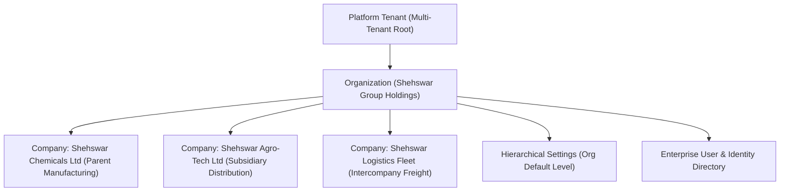

# Organization Management Architecture & Specification

## 1. Executive Overview

In **SHEHSWAR ONE360**, the `Organization` entity represents the top-level corporate holding, conglomerate, or group entity that sits at the apex of the enterprise hierarchy. It anchors all organizational governance, consolidates multiple operating legal entities (companies), and provides tenant-level multi-tenancy isolation.

---

## 2. Entity Schema & Standards

Following Phase 1 database engineering guidelines, the `Organization` table is indexed by a time-sortable **UUIDv7** primary key and incorporates complete enterprise auditing and regional configuration.

| Field | Type | Constraint | Description |
| :--- | :--- | :--- | :--- |
| `id` | `VARCHAR(36)` | `PRIMARY KEY` | UUIDv7 time-sortable globally unique identifier |
| `tenantId` | `VARCHAR(36)` | `NOT NULL, FK` | Foreign key referencing `PlatformTenant` (data isolation) |
| `code` | `VARCHAR(50)` | `UNIQUE, NOT NULL` | Business identifier (e.g. `SHEHSWAR-GRP`) |
| `name` | `VARCHAR(255)` | `NOT NULL` | Brand / commercial group name |
| `legalName` | `VARCHAR(255)` | `NULLABLE` | Registered legal corporate holding name |
| `logoUrl` | `VARCHAR(500)` | `NULLABLE` | Corporate brand mark URL |
| `industry` | `VARCHAR(100)` | `NULLABLE` | Primary industry sector (e.g. `Chemicals, Agro-Tech`) |
| `country` | `VARCHAR(100)` | `NOT NULL` | Country of primary corporate registration (e.g. `Pakistan`) |
| `currency` | `VARCHAR(10)` | `NOT NULL` | Group base currency code (e.g. `PKR`) |
| `timezone` | `VARCHAR(50)` | `NOT NULL` | Group operational timezone (e.g. `Asia/Karachi`) |
| `email` | `VARCHAR(255)` | `NULLABLE` | Central corporate communications email |
| `phone` | `VARCHAR(50)` | `NULLABLE` | Central corporate phone switchboard |
| `address` | `TEXT` | `NULLABLE` | Registered headquarters postal address |
| `isActive` | `BOOLEAN` | `NOT NULL, DEFAULT true` | Operational activation switch |
| `createdBy` | `VARCHAR(255)` | `NOT NULL` | Audit user ID who initialized the holding |
| `createdAt` | `TIMESTAMPTZ` | `NOT NULL` | Record generation timestamp |
| `updatedAt` | `TIMESTAMPTZ` | `NOT NULL` | Latest schema/data modification timestamp |

---

## 3. API Contract Standards

All administrative operations on `Organization` are exposed under `/api/v1/master-data/organizations` and strictly require `JwtAuthGuard`, `RolesGuard`, and `PermissionsGuard`.

### Endpoints
- `GET /api/v1/master-data/organizations`: List organizations with pagination, search, and status filters.
- `GET /api/v1/master-data/organizations/:id`: Retrieve 360° organization record with linked companies count.
- `POST /api/v1/master-data/organizations`: Create new enterprise organization.
- `PUT /api/v1/master-data/organizations/:id`: Update corporate metadata and regional configurations.
- `DELETE /api/v1/master-data/organizations/:id`: Deactivate or remove holding.

---

## 4. UI Architecture & Responsive Interaction

The user interface is built using the Phase 2 Page Templates and Atomic Design Tokens:
- **List View**: Built with `ListPageTemplate`, providing real-time code/brand search, status pills (`ACTIVE`, `INACTIVE`), KPI metric cards, and responsive data table.
- **Detail View**: Built with `DetailPageTemplate`, displaying 360° metrics, subsidiaries list, executive team, regional settings, and an immutable audit timeline.
- **Create/Edit Form**: Built with `FormPageTemplate`, divided into:
  1. *Basic Information*: Code, commercial name, legal name, industry.
  2. *Regional & Financial*: Country, group currency, timezone.
  3. *Contact Information*: Email, phone, headquarters address.
  4. *Governance Status*: Operational activation toggle.
