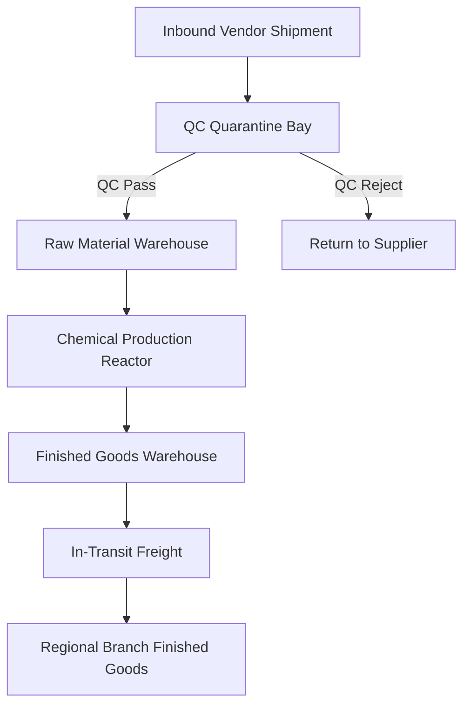

# Warehouse Management Architecture & Specification

## 1. Executive Overview

In **SHEHSWAR ONE360**, the `Warehouse` entity represents a physical or logical storage facility where raw materials, packaging supplies, chemical ingredients, work-in-progress (WIP), and finished goods are stored and controlled. 

### Mandatory Warehouse Classifications
1. **Raw Material (RAW_MATERIAL)**: Bulk industrial acids, salts, surfactants, and chemical precursors.
2. **Finished Goods (FINISHED_GOODS)**: Ready-for-sale formulated agrochemicals, fertilizers, and packaged containers.
3. **Packing Material (PACKING_MATERIAL)**: HDPE drums, labels, caps, safety seals, and corrugated cartons.
4. **In-Transit Freight (TRANSIT)**: Virtual warehouse holding stock moving between factories or to regional branches.
5. **QC Quarantine Bay (QUARANTINE)**: Isolated physical/logical bay where inbound deliveries or untested batches await laboratory clearance.
6. **Customer Returns (RETURNS)**: Segregated facility for returned, damaged, or expired stock.

---

## 2. Entity Schema & Standards

| Field | Type | Constraint | Description |
| :--- | :--- | :--- | :--- |
| `id` | `VARCHAR(36)` | `PRIMARY KEY` | UUIDv7 primary identifier |
| `organizationId` | `VARCHAR(36)` | `NOT NULL, FK` | Enterprise holding scope |
| `companyId` | `VARCHAR(36)` | `NOT NULL, FK` | Owning legal entity |
| `plantId` | `VARCHAR(36)` | `NULLABLE, FK` | Manufacturing plant association (if factory warehouse) |
| `branchId` | `VARCHAR(36)` | `NULLABLE, FK` | Regional branch association (if regional depot) |
| `code` | `VARCHAR(50)` | `NOT NULL` | Warehouse code (e.g. `WH-KSK-RAW`) |
| `name` | `VARCHAR(255)` | `NOT NULL` | Descriptive facility title |
| `type` | `VARCHAR(50)` | `NOT NULL` | Classification (`RAW_MATERIAL`, `FINISHED_GOODS`, etc.) |
| `location` | `VARCHAR(255)` | `NOT NULL` | Zone / bay / yard coordinates |
| `address` | `TEXT` | `NULLABLE` | Facility postal address |
| `managerName` | `VARCHAR(255)` | `NULLABLE` | Warehouse Supervisor / Inventory Controller |
| `isActive` | `BOOLEAN` | `NOT NULL, DEFAULT true` | Active operational status |
| `createdAt` | `TIMESTAMPTZ` | `NOT NULL` | Record creation timestamp |
| `updatedAt` | `TIMESTAMPTZ` | `NOT NULL` | Last modified timestamp |

---

## 3. Strict Boundary Rules

- **Zero Operational Stock in Phase 3**: Phase 3 creates the master data foundation only. Stock valuation tables, bin locations, batch quantity ledgers, and goods receipts belong strictly to Phase 4.
- **Phase 4 Readiness**: Every warehouse record features a Phase 4 Inventory Placeholder tab in its detail page.

---

## 4. UI Architecture & Features

- **Warehouse List**: Categorized by classification badge (color-coded for Raw, FG, Packing, Transit, Quarantine, Returns), company, and status.
- **Warehouse Detail**:
  - *Overview*: Identification, location coordinates, supervisor assignment, and operational status.
  - *Phase 4 Placeholder*: Clean enterprise container showing future inventory valuation and bin structure architecture.
  - *Activity & Timeline*: Change log tracking status modifications and supervisor changes.
- **Warehouse Form**: Modal or page-based editor with dropdowns for classification types, linked plant, and supervisor assignment.
