# SHEHSWAR ONE360 — Goods Receipt Note (GRN) Foundation

## 1. Scope & Architectural Boundary (Phase 4 Strict Rule)
The **Goods Receipt Note (GRN)** in Phase 4 serves as the formal **procurement receiving document and physical gate verification record**. 

> [!IMPORTANT]
> **Strict Architectural Boundary:** Phase 4 creates the receiving documentation foundation only. It **does NOT** perform inventory ledger movements, stock valuation updates, or bin location balance adjustments. All physical inventory movements and warehouse ledger postings strictly belong to the upcoming **Phase 5 — Inventory Management** upon formal QC clearance and stock receipt transfer.

---

## 2. Receiving Data Entity

```text
+-------------------------------------------------------------+
|                   GOODS RECEIPT NOTE (GRN)                  |
+-------------------------------------------------------------+
| grnNumber: SH-GRN-2026-000078 (Atomic via DocumentNumbering)|
| poId / poNumber: Reference to Approved Purchase Order       |
| organizationId / companyId: Multi-tenant / Multi-company     |
| vendorName & vendorCode: Supplier identification            |
| warehouseName: E.g., Raw Materials Warehouse 1 (Sheikhupura)|
| receivedDate: Arrival date                                  |
| receivedByName: Warehouse receiving officer                 |
| carrierName: E.g., TCS Cargo, POL Cryo-Fleet               |
| vehicleNumber: E.g., LES-9942, KHI-7721                     |
| deliveryNoteNumber: Vendor's delivery challan / gate pass   |
| status: DRAFT | RECEIVED | QUALITY_PENDING | ACCEPTED...    |
| qcStatus: PENDING | PASSED | PARTIALLY_ACCEPTED | REJECTED  |
| qcNotes: Laboratory analytical report, moisture %, COA      |
+-------------------------------------------------------------+
                              | 1
                              |
                              | N
+-------------------------------------------------------------+
|                  GOODS RECEIPT NOTE ITEM                    |
+-------------------------------------------------------------+
| poItemId: Reference to PO line item                         |
| itemName: Nitric Acid 68%, HDPE Bags 50kg, etc.             |
| orderedQuantity: Total contracted under PO                  |
| receivedQuantity: Physical quantity offloaded               |
| acceptedQuantity: Passed QC testing                         |
| rejectedQuantity: Failed specifications (out of spec)       |
| unit: TON, BAG, KG, DRUM                                    |
| packageCondition: INTACT | DAMAGED | LEAKING | SEAL_BROKEN  |
| batchNumber: Manufacturer batch / lot number                |
| expiryDate: Re-test / expiration date                       |
+-------------------------------------------------------------+
```

---

## 3. Physical Receiving & Quality Inspection Lifecycle

```mermaid
stateDiagram-v2
    [*] --> DRAFT : Consignment arrives at Factory Gate
    DRAFT --> RECEIVED : Gate pass & physical count verified
    RECEIVED --> QUALITY_PENDING : Samples drawn for QA Lab assay
    QUALITY_PENDING --> ACCEPTED : Lab confirms COA & specs
    QUALITY_PENDING --> REJECTED : Contamination / Failed purity
    QUALITY_PENDING --> PARTIALLY_ACCEPTED : Partial lot accepted; balance rejected
    ACCEPTED --> [*] : Ready for Phase 5 Stock Receipt Posting
```



---

## 4. Quality Inspection Placeholder
To facilitate production operations while Phase 5 (Inventory & QC) is introduced:
- A dedicated **Quality Inspection Modal** allows authorized QA Officers to record analytical test findings (e.g., acid concentration %, moisture content, tensile strength), assign inspection status (`PASSED`, `REJECTED`, `WAIVED`), adjust accepted vs rejected quantities, and log official laboratory remarks.
- Rejection quantities are automatically aggregated into supplier performance metrics.
