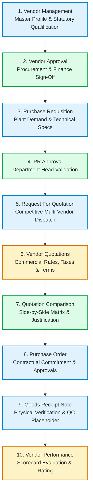

# SHEHSWAR ONE360 — End-to-End Procurement Lifecycle Workflows

## 1. Master Procurement Lifecycle Architecture

The operational procurement lifecycle connects departmental demand with supplier fulfillment across 9 distinct milestones:

---

## 2. Milestone Workflows & Departmental Responsibilities

### Step 1: Vendor Qualification & Master Registration
- **Actors:** Supplier Representative, Procurement Officer, Finance Tax Auditor
- **Actions:** Capture NTN, STRN, manufacturing category, banking details, ISO certificates, and credit limits.
- **Audit & Notification:** Triggers `vendor.created` and notifies Procurement Manager.

### Step 2: Multi-Tier Vendor Approval
- **Actors:** Procurement Manager, Finance Controller, Managing Director
- **Actions:** Verifies active tax filer status, sets credit ceiling, approves vendor.
- **State Transition:** `DRAFT` $\to$ `PENDING_APPROVAL` $\to$ `APPROVED`.

### Step 3: Purchase Requisition (PR)
- **Actors:** Plant Chemical Production Engineer, Packaging Superintendent, Maintenance Lead
- **Actions:** Specifies items, required date (e.g. for crop sowing season), priority, and technical tolerances.
- **State Transition:** `DRAFT` $\to$ `SUBMITTED` $\to$ `PENDING_APPROVAL` $\to$ `APPROVED`.

### Step 4: Request For Quotation (RFQ)
- **Actors:** Procurement Officer, Approved Tier-1 Vendors
- **Actions:** Selects multiple pre-qualified vendors, defines submission deadline, and issues formal RFQ notice.
- **State Transition:** `DRAFT` $\to$ `SENT` $\to$ `QUOTATION_RECEIVED` $\to$ `COMPARISON_COMPLETED`.

### Step 5: Vendor Quotation Entry & Validation
- **Actors:** Vendor, Procurement Officer
- **Actions:** Records unit rates, delivery lead days, GST (18%), discounts, payment terms, and validity windows.
- **State Transition:** `RECEIVED` $\to$ `UNDER_REVIEW` $\to$ `SELECTED` / `REJECTED`.

### Step 6: Quotation Comparison & Award
- **Actors:** Procurement Evaluation Committee, Plant Director, CFO
- **Actions:** Side-by-side comparison across unit rates, lead time, credit terms, and total net outlays; awards winner with mandatory audit justification.

### Step 7: Purchase Order (PO) Issuance & Execution
- **Actors:** Procurement Head, Vendor Sales Executive
- **Actions:** Generates atomic PO number via `DocumentNumberingService`, commits contract, issues to supplier.
- **State Transition:** `DRAFT` $\to$ `SUBMITTED` $\to$ `APPROVED` $\to$ `SENT_TO_VENDOR`.

### Step 8: Goods Receipt Note (GRN) & Physical Receiving
- **Actors:** Factory Gate Receiving Officer, Plant QA Chemist
- **Actions:** Offloads bulk tanker or bagged shipment, records delivery challan, logs packaging condition, takes lab samples for QC assay.
- **State Transition:** `DRAFT` $\to$ `RECEIVED` $\to$ `QUALITY_PENDING` $\to$ `ACCEPTED` / `REJECTED`.

### Step 9: Vendor Performance Feedback Loop
- **Actors:** System Performance Analytics Engine
- **Actions:** Aggregates delivery punctuality, lead time variance, and QC lot rejection rate to compute updated composite scorecard rating (out of 5.00).
