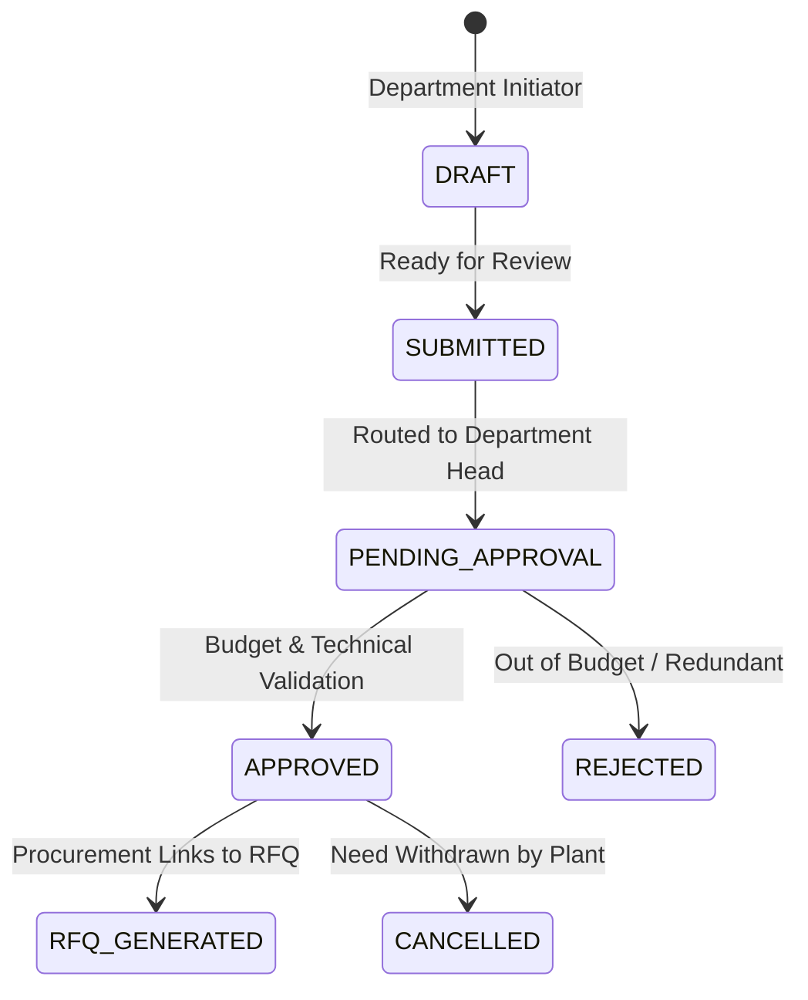

# SHEHSWAR ONE360 — Purchase Requisition (PR) Management

## 1. Business Context & Purpose
In agrochemical and fertilizer manufacturing plants (e.g., Sheikhupura Complex), production lines, maintenance workshops, quality control laboratories, and packaging departments generate procurement requirements for operational continuity. The **Purchase Requisition (PR)** acts as the internal demand capture document prior to commercial commitments.

---

## 2. Data Structure

### Requisition Header
- **id:** UUIDv7
- **organizationId / companyId:** Multi-tenant scoping
- **departmentId:** Requesting plant department (e.g., Chemical Batching, Slurry Neutralization)
- **prNumber:** Atomic formatted identifier generated via `DocumentNumberingService` (e.g., `SH-PR-2026-000084`)
- **requestedById:** Requesting engineer / superintendent
- **requiredDate:** Plant deadline (critical for seasonal crop cycles like Rabi/Kharif sowing)
- **priority:** `LOW`, `NORMAL`, `HIGH`, `URGENT`
- **purpose:** Engineering justification
- **status:** `DRAFT`, `SUBMITTED`, `PENDING_APPROVAL`, `APPROVED`, `REJECTED`, `CANCELLED`

### Requisition Line Items
- **itemName:** Detailed material description (e.g., *Nitric Acid 68% Technical Grade*)
- **category:** `RAW_MATERIAL`, `PACKING_MATERIAL`, `SPARE_PARTS`, `SERVICES`
- **quantity & unit:** Numeric quantity and standard unit (e.g., `TON`, `KG`, `BAG`, `PIECE`, `DRUM`)
- **requiredDate:** Specific arrival target
- **specification:** Physicochemical tolerances (e.g., Specific gravity 1.41 @ 20C, Chlorides < 5ppm)
- **estimatedRate & estimatedAmount:** Departmental budget estimation

---

## 3. PR Lifecycle & Departmental Governance

---

## 4. UI Architecture & Features
1. **List Page:** Real-time filtering by plant department, priority urgency flag, status badge, search by PR number or purpose, and quick KPI summary cards.
2. **Detail Page:** 360-degree view with multi-item breakdown, estimated spend, department head approval timeline, comments, and direct action to spawn RFQ.
3. **Form Page:** Dynamic row creation for requisition line items with automatic subtotal calculation and client-side validation.
