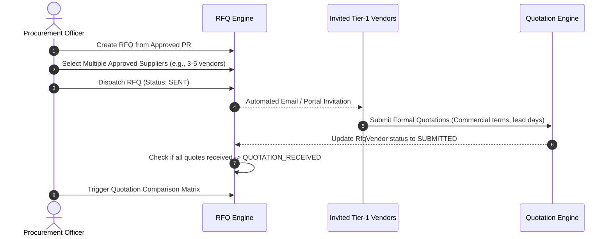

# SHEHSWAR ONE360 — Request For Quotation (RFQ)

## 1. Domain Objective
The **Request For Quotation (RFQ)** process facilitates competitive market price discovery by inviting multiple pre-qualified vendors to submit commercial bids against approved Purchase Requisitions.

---

## 2. RFQ Structure & Multi-Vendor Mechanics

```text
+-----------------------------------------------------------+
|               REQUEST FOR QUOTATION (RFQ)                 |
+-----------------------------------------------------------+
| rfqNumber: SH-RFQ-2026-000041                             |
| prId / prNumber: Linked Purchase Requisition              |
| title: Q4 Supply of Nitric & Phosphoric Acids            |
| issueDate: 2026-09-10                                     |
| deadline: 2026-09-18                                      |
| status: DRAFT | SENT | QUOTATION_RECEIVED | COMPARISON... |
| notes: Handling parameters, purity, COA stipulations     |
+-----------------------------------------------------------+
                             | 1
                             |
                             | N
+-----------------------------------------------------------+
|                        RFQ VENDOR                         |
+-----------------------------------------------------------+
| vendorId: Reference to Vendor Master                      |
| vendorCode: VND-ENG-01, VND-POL-03, VND-DES-04            |
| status: INVITED | VIEWED | SUBMITTED | DECLINED           |
| hasQuotation: Boolean                                     |
+-----------------------------------------------------------+
```

---

## 3. Workflow Progression



---

## 4. Business Validation Rules
1. **Pre-qualified Vendors Only:** Only suppliers in `APPROVED` status can be invited to participate in an RFQ.
2. **Deadline Enforcement:** Quotation entries attempted past the `deadline` timestamp flag an exception warning requiring procurement manager authorization.
3. **Audit Tracking:** The dispatch of RFQs, deadline extensions, and vendor additions are logged in the audit ledger.
