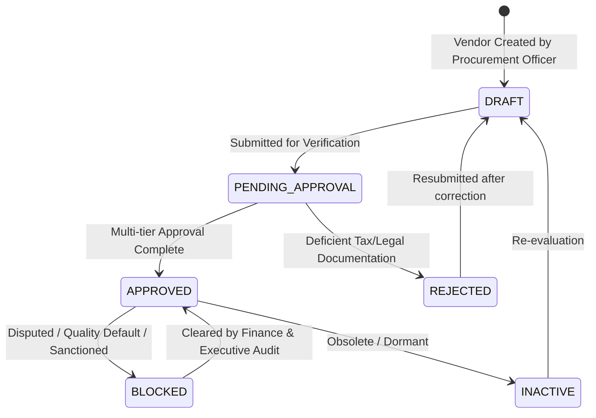

# SHEHSWAR ONE360 — Vendor Master Management

## 1. Domain Overview
The **Vendor Master** represents the single source of truth for all supplier entities interacting with the SHEHSWAR Group enterprise network. Designed specifically for agricultural chemical and fertilizer manufacturing operations, it captures extensive fiscal, registration, banking, logistical, and material category qualifications.

---

## 2. Multi-Tier Entity Model

```text
+-------------------------------------------------------------+
|                          VENDOR                             |
+-------------------------------------------------------------+
| id: UUIDv7                                                  |
| organizationId: UUID (Tenant isolation)                    |
| companyId: UUID (Entity ownership & multi-company sharing) |
| code: String (e.g., VND-ENG-01)                             |
| name: String (Trade / Display name)                         |
| legalName: String (Statutory tax name)                      |
| vendorType: RAW_MATERIAL | PACKING | SERVICE | TRANSPORT... |
| category: String (e.g., Industrial Precursors, Bags)        |
| status: DRAFT | PENDING_APPROVAL | APPROVED | BLOCKED...    |
+-------------------------------------------------------------+
| Registration & Commercial Details:                          |
| - NTN: National Tax Number                                  |
| - STRN: Sales Tax Registration Number                       |
| - Currency: ISO 4217 (PKR, USD, EUR)                        |
| - PaymentTerms: 30_DAYS_CREDIT, ADVANCE_PAYMENT, etc.       |
| - CreditLimit: Decimal                                      |
| - BankDetails: JSON (IBAN, Bank Name, Branch, Swift)        |
+-------------------------------------------------------------+
                              | 1
                              |
                              | N
+-------------------------------------------------------------+
|                      VENDOR DOCUMENT                        |
+-------------------------------------------------------------+
| documentType: CONTRACT | TAX_CERTIFICATE | ISO_CERTIFICATE  |
| documentName: String                                        |
| fileUrl: String                                             |
| fileSize: Int                                               |
| expiryDate: DateTime?                                       |
+-------------------------------------------------------------+
```

---

## 3. Vendor Types & Fertilizer Group Use Cases

| Vendor Type | Core Commodities / Services | Example Suppliers |
| :--- | :--- | :--- |
| **RAW_MATERIAL** | Nitric Acid, Phosphoric Acid, Rock Phosphate, Ammonia | Engro Chemicals, Pakistan Oxygen |
| **PACKING_MATERIAL** | 50kg HDPE Woven Bags, Poly Drums, Inner Liners | National Packaging Solutions |
| **SERVICE_PROVIDER** | Plant Calibration, Boiler Inspection, Analytical Testing | SGS, Bureau Veritas |
| **TRANSPORT** | Bulk Tanker Haulage, Flatbed Logistics, Dispatch | Al-Noor Freight, TCS Cargo |
| **MACHINERY** | High-chrome Slurry Pumps, Impellers, Filter Presses | Descon Engineering, KSB Pumps |

---

## 4. Vendor Lifecycle & Status State Machine



### Business Rules Enforced
1. **Purchase Order Restriction:** Only vendors with `status === VendorStatus.APPROVED` are eligible to be awarded purchase contracts or linked to Purchase Orders (`PO`).
2. **Duplicate Prevention:** The backend service strictly validates unique `NTN` (National Tax Number) and `code` within the company/organization boundary to prevent fraudulent duplicate supplier profiles.
3. **Audit Trail:** Every status change, credit limit adjustment, and document upload triggers an immutable event logged via the platform `AuditService`.
